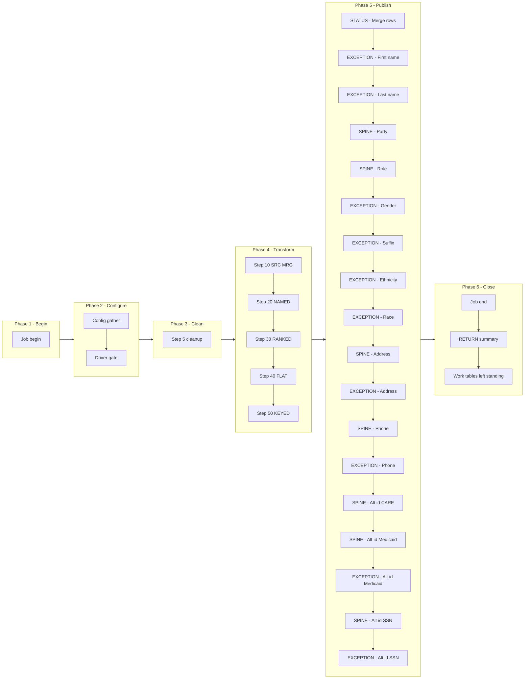

# CRE_CARE Manifest — m_Tgt_C_S_CRE_CARE_Clients, config-driven step-driver refactor (CRE ONLY)

Prefix: `CRE_CARE`. Base dir: `snowflake_all_drivers/CRE/`.
Baseline (read-only, never modified by this migration):
`snowflake_multisource/CRE/mappings/sp_snow_main_m_Tgt_C_S_CRE_CARE_Clients.sql`
(step map §1 of `snowflake_multisource/CRE/STEP_MAP_CRE.md` agrees; where the task
brief, the step map and the file agreed, no discrepancy was found — see Deviations).

## Driver

Signature (IDENTICAL to the current main, verified by normalised comparison):

```sql
sp_snow_main_m_Tgt_C_S_CRE_CARE_Clients (
    P_PHYSICAL_ADDR_TYPE_CD  VARCHAR DEFAULT '002',
    P_RLE_BO_CLASS_CD_MEMBER VARCHAR DEFAULT 'Member',
    P_DEFAULT_TX_STATE_CD    VARCHAR DEFAULT '48',
    P_COUNTY_CD_NONTX        VARCHAR DEFAULT '996',
    P_COUNTYCD_DEFAULTALL    VARCHAR DEFAULT '998',
    P_DEFAULT_NONUS_STATE_CD VARCHAR DEFAULT '99',
    P_JOB_RUN_ID             VARCHAR DEFAULT NULL
) RETURNS VARCHAR
```

File: `drivers/driver_sp_snow_main_m_Tgt_C_S_CRE_CARE_Clients.sql`

Driver behaviour: job-run-id generation exactly as now + `sp_etl_job_begin`;
one config GATHER (nested `BEGIN/EXCEPTION`, defaults stand on failure) from
`COMMON.ETL_RUN_CONFIG_TBL` (`WORKFLOW_NAME = 'wf_CRE_Stage_Load_Ongoing'`,
`MAPPING_NAME = 'm_Tgt_C_S_CRE_CARE_Clients'`); driver-row `STEP_NO = 0` = `'N'` skips the
whole mapping BEFORE step 5 cleanup (SKIPPED checkpoint `MAPPING_SKIPPED`,
`sp_etl_job_finish` with a skipped message, early RETURN); step 5 cleanup
unchanged (5 bare `DROP TABLE IF EXISTS`, no checkpoint); conditional step
calls in order; ONE publish transaction calling the enabled branch procs in
order; branch checkpoints ONLY after `COMMIT`; `TERMINATING` via
`sp_etl_job_finish` with the same message style and RETURN format as now;
exception block identical in shape (ROLLBACK + TERMINATING `JOB_END`
FAILED checkpoint — v2 10-argument form + `sp_etl_job_fail` + RAISE).

Flag / input / publish-count naming rule (applied uniformly): strip the
`sp_snow_step_` / `sp_snow_pub_` prefix from the unit's procedure name,
prepend `l_flag_` / `l_in_` / `l_pub_`; the driver-row flag is
`l_flag_CRE_CARE_DRIVER`. Examples: `sp_snow_step_CRE_CARE_S10_SRC_MRG` →
`l_flag_CRE_CARE_S10_SRC_MRG` / `l_in_CRE_CARE_S10_SRC_MRG`;
`sp_snow_pub_CRE_CARE_CRE_SRC_MRG` → `l_flag_CRE_CARE_CRE_SRC_MRG` /
`l_in_CRE_CARE_CRE_SRC_MRG` / `l_pub_CRE_CARE_CRE_SRC_MRG`. No numeric-only
flag names, no ancestry suffixes, no mixed legacy families. Dependencies live
in the `l_in_*` variables, in the config DEPENDENT_ON column, and in
`CRE_DEPENDENCIES.md` — never in flag names.

## Steps

| STEP_NO | Proc | Kind | Produces | Consumes default | Original params used | Checkpoint STEP_NAME |
|---|---|---|---|---|---|---|
| 10 | `sp_snow_step_CRE_CARE_S10_SRC_MRG` | TRANSFORM | `WRK_CRE_CARE_S1_SRC_MRG` — CARE snapshot + merge routing | _(empty — check skipped; reads base tables, not work tables)_ | none | `SRC_MERGE_ROUTING` |
| 20 | `sp_snow_step_CRE_CARE_S20_NAMED` | TRANSFORM | `WRK_CRE_CARE_S2_NAMED` — standardised names + member validity | `WRK_CRE_CARE_S1_SRC_MRG` | none | `NAME_STANDARDISE_VALIDATE` |
| 30 | `sp_snow_step_CRE_CARE_S30_RANKED` | TRANSFORM | `WRK_CRE_CARE_S3_RANKED` — rank + validation enrichment | `WRK_CRE_CARE_S2_NAMED` | none | `RANK_ENRICH` |
| 40 | `sp_snow_step_CRE_CARE_S40_FLAT` | TRANSFORM | `WRK_CRE_CARE_S4_FLAT` — flattened load-ready rows | `WRK_CRE_CARE_S3_RANKED` | `P_RLE_BO_CLASS_CD_MEMBER`, `P_DEFAULT_NONUS_STATE_CD` | `FLAT_ADDR_ALTID` |
| 50 | `sp_snow_step_CRE_CARE_S50_KEYED` | TRANSFORM | `WRK_CRE_CARE_S5_KEYED` — route flags + unique-key guards | `WRK_CRE_CARE_S4_FLAT` | `P_PHYSICAL_ADDR_TYPE_CD`, `P_RLE_BO_CLASS_CD_MEMBER`, `P_DEFAULT_TX_STATE_CD`, `P_COUNTY_CD_NONTX`, `P_COUNTYCD_DEFAULTALL` | `KEYED_ROUTES_GUARDS` |

Step proc signatures: the step's used original params (in original order) +
`P_JOB_RUN_ID VARCHAR` + `P_RUN_TS TIMESTAMP_NTZ` + `P_INPUT_TABLES VARCHAR
DEFAULT '<consumes default>'`. Steps 40 and 50 carry `DEFAULT NULL` on
`P_JOB_RUN_ID` / `P_RUN_TS` (live-compile fix: Snowflake forbids a required
parameter after an optional one; drivers pass all parameters positionally, so
behaviour is unchanged). Steps 10/20/30 have no original params, so their
`P_JOB_RUN_ID` / `P_RUN_TS` are required and `P_INPUT_TABLES` is the only
optional parameter. Every step proc returns `NUMBER` (row count), writes its
own checkpoint in the v2 10-argument form (kept values: source, job,
workflow, mapping, state, step name, status, target, message
`'Step <n> complete.'`, error NULL; row count, work-table name/action/
purpose dropped per the new signature), has no exception block, no
transaction, no target write, and starts with the work-table existence
check (skipped when `P_INPUT_TABLES` is NULL/empty). `P_INPUT_TABLES` is a
dependency declaration + runtime check, NOT dynamic SQL — Snowflake cannot
parameterise table names in static SQL, so each CTAS still names its source
work table literally. The existence check probes the first missing table with
`EXECUTE IMMEDIATE 'SELECT 1 FROM <table>'` so the native object-not-exists
error surfaces (a RAISE cannot carry a dynamic table name).

Step files: `steps/sp_snow_step_CRE_CARE_S<nn>_<NAME>.sql` (5 files).

## Publish branches

Original publish was one step 60 with 18 INSERTs in one transaction. Each
INSERT is now one branch proc, called by the driver inside ONE transaction
in the same order, checkpointed by the driver only after COMMIT. Publish
stays ONE transaction phase: all eighteen branches sit inside the single
Publish subgraph of the phase-flow diagram below, distinguished by SPINE /
STATUS / EXCEPTION label prefixes — never split across subgraphs.

| STEP_NO | Proc | Kind | Target | Consumes | Original branch | Guard |
|---|---|---|---|---|---|---|
| 60 | `sp_snow_pub_CRE_CARE_CRE_SRC_MRG` | STATUS | `CRE_SRC_MRG` | `WRK_CRE_CARE_S5_KEYED` | 60a | `grp_mrg` |
| 70 | `sp_snow_pub_CRE_CARE_EXC_STG_BAD_REC_MEMB_FIRST_NAME` | EXCEPTION | `EXC_STG_BAD_REC_MEMB` | `WRK_CRE_CARE_S5_KEYED` | 60b | `grp_first_name AND uq_first_name` |
| 80 | `sp_snow_pub_CRE_CARE_EXC_STG_BAD_REC_MEMB_LAST_NAME` | EXCEPTION | `EXC_STG_BAD_REC_MEMB` | `WRK_CRE_CARE_S5_KEYED` | 60c | `grp_last_name AND uq_last_name` |
| 90 | `sp_snow_pub_CRE_CARE_C_S_CRE_PTY` | SPINE | `C_S_CRE_PTY` | `WRK_CRE_CARE_S5_KEYED` | 60d | `is_member AND uq_pty` |
| 100 | `sp_snow_pub_CRE_CARE_C_S_CRE_PTY_RLE` | SPINE | `C_S_CRE_PTY_RLE` | `WRK_CRE_CARE_S5_KEYED` | 60e | `is_member AND uq_rle` |
| 110 | `sp_snow_pub_CRE_CARE_EXC_STG_BAD_REC_MEMB_GENDER` | EXCEPTION | `EXC_STG_BAD_REC_MEMB` | `WRK_CRE_CARE_S5_KEYED` | 60f | `grp_gender` |
| 120 | `sp_snow_pub_CRE_CARE_EXC_STG_BAD_REC_MEMB_SUFFIX` | EXCEPTION | `EXC_STG_BAD_REC_MEMB` | `WRK_CRE_CARE_S5_KEYED` | 60g | `grp_suffix` |
| 130 | `sp_snow_pub_CRE_CARE_EXC_STG_BAD_REC_MEMB_ETHNICITY` | EXCEPTION | `EXC_STG_BAD_REC_MEMB` | `WRK_CRE_CARE_S5_KEYED` | 60h | `grp_ethnicity` |
| 140 | `sp_snow_pub_CRE_CARE_EXC_STG_BAD_REC_MEMB_RACE` | EXCEPTION | `EXC_STG_BAD_REC_MEMB` | `WRK_CRE_CARE_S5_KEYED` | 60i | `grp_race` |
| 150 | `sp_snow_pub_CRE_CARE_C_S_CRE_PTY_RLE_ADDR` | SPINE | `C_S_CRE_PTY_RLE_ADDR` | `WRK_CRE_CARE_S5_KEYED` | 60j | `grp_addr AND uq_addr` |
| 160 | `sp_snow_pub_CRE_CARE_EXC_STG_BAD_REC_MEMB_ADDR` | EXCEPTION | `EXC_STG_BAD_REC_MEMB` | `WRK_CRE_CARE_S5_KEYED` | 60k | `grp_addr_exc` |
| 170 | `sp_snow_pub_CRE_CARE_C_S_CRE_PTY_RLE_PHN` | SPINE | `C_S_CRE_PTY_RLE_PHN` | `WRK_CRE_CARE_S5_KEYED` | 60l | `grp_phone AND uq_phone` |
| 180 | `sp_snow_pub_CRE_CARE_EXC_STG_BAD_REC_MEMB_PHONE` | EXCEPTION | `EXC_STG_BAD_REC_MEMB` | `WRK_CRE_CARE_S5_KEYED` | 60m | `grp_phone_exc` |
| 190 | `sp_snow_pub_CRE_CARE_C_S_CRE_PTY_RLE_ALT_ID_CARE` | SPINE | `C_S_CRE_PTY_RLE_ALT_ID` | `WRK_CRE_CARE_S5_KEYED` | 60n | `grp_care_alt AND uq_care_alt` |
| 200 | `sp_snow_pub_CRE_CARE_C_S_CRE_PTY_RLE_ALT_ID_MEDICAID` | SPINE | `C_S_CRE_PTY_RLE_ALT_ID` | `WRK_CRE_CARE_S5_KEYED` | 60o | `grp_medicaid_alt AND uq_medicaid_alt` |
| 210 | `sp_snow_pub_CRE_CARE_EXC_STG_BAD_REC_MEMB_MEDICAID_ALT` | EXCEPTION | `EXC_STG_BAD_REC_MEMB` | `WRK_CRE_CARE_S5_KEYED` | 60p | `grp_medicaid_exc AND uq_medicaid_exc` |
| 220 | `sp_snow_pub_CRE_CARE_C_S_CRE_PTY_RLE_ALT_ID_SSN` | SPINE | `C_S_CRE_PTY_RLE_ALT_ID` | `WRK_CRE_CARE_S5_KEYED` | 60q | `grp_ssn_alt AND uq_ssn_alt` |
| 230 | `sp_snow_pub_CRE_CARE_EXC_STG_BAD_REC_MEMB_SSN_ALT` | EXCEPTION | `EXC_STG_BAD_REC_MEMB` | `WRK_CRE_CARE_S5_KEYED` | 60r | `grp_ssn_exc AND uq_ssn_exc` |

Branch proc signatures: `P_JOB_RUN_ID VARCHAR` + `P_RUN_TS TIMESTAMP_NTZ` +
`P_INPUT_TABLES VARCHAR DEFAULT 'WRK_CRE_CARE_S5_KEYED'`, no original params
(no branch INSERT references any original parameter or the run timestamp
directly — each reads the `run_ts` / `mapping_name` columns materialised in
step 50, so `P_RUN_TS` is carried for a uniform driver call signature and is
unused in branch bodies; this is stated in each branch header). Each returns
`SQLROWCOUNT` as `NUMBER`. No transaction control, no checkpoint calls.
Driver checkpoint STEP_NAMEs: `PUBLISH_CRE_SRC_MRG`,
`PUBLISH_EXC_FIRST_NAME`, `PUBLISH_EXC_LAST_NAME`, `PUBLISH_C_S_CRE_PTY`,
`PUBLISH_C_S_CRE_PTY_RLE`, `PUBLISH_EXC_GENDER`, `PUBLISH_EXC_SUFFIX`,
`PUBLISH_EXC_ETHNICITY`, `PUBLISH_EXC_RACE`, `PUBLISH_C_S_CRE_PTY_RLE_ADDR`,
`PUBLISH_EXC_ADDR`, `PUBLISH_C_S_CRE_PTY_RLE_PHN`, `PUBLISH_EXC_PHONE`,
`PUBLISH_ALT_ID_CARE`, `PUBLISH_ALT_ID_MEDICAID`, `PUBLISH_EXC_MEDICAID_ALT`,
`PUBLISH_ALT_ID_SSN`, `PUBLISH_EXC_SSN_ALT`.

Branch files: `publish/sp_snow_pub_CRE_CARE_<TARGET>[_<BRANCH>].sql` (18 files).
`CRE_SRC_MRG` is kind STATUS (merge-routing output, not a `C_S_*` spine
table); the seven `C_S_*` branches are SPINE; the ten `EXC_STG_BAD_REC_MEMB`
branches are EXCEPTION.

## Phase-flow diagram

Six phases following the actual driver flow. Publish is a single phase
(single subgraph, single transaction); spine / status / exception groups are
distinguished by label prefixes inside it. Mermaid source only, never a
rendered image.



## Preserved quirks (from the main header, unchanged from the original)

- Insert-only: no TRUNCATE, no DELETE of targets. IDQ truncates the targets;
  the Snowflake version skips keys already present (uq_pty / uq_rle / uq_addr /
  uq_phone / uq_care_alt / uq_medicaid_alt / uq_ssn_alt guards, VERSION_SEQ = 1
  in the targets). A re-run inserts nothing twice, but does not remove rows
  that IDQ would have truncated away.
- Invalid members are logged and dropped; a bad address, phone or alternate id
  is logged instead of loaded (the member itself is still loaded). SSN 'U' /
  'N' is blanked and dropped; CARE and Medicaid ids of 'U' / 'N' are blanked
  for the loaded value (the key still uses the raw id). Ids lose special
  characters (inside the helpers) and are cut to 10 characters; phones are cut
  to 10 digits; SRC_ROWID is cut to 30 characters.
- With the pass-through address validator (no score, no match code) the
  valid-US-address condition is NULL, so every US address is an exception
  (the NVL(..., FALSE) in the flat step).
- TIMELINE: VERSION_SEQ = VERSION_SEQ_NUM (the rank per CARE id; 1 for every
  written row). 'B' and 'D' rows are end-dated: PERIOD_START_DATE =
  CARE_LASTUP_DT - 1 day, PERIOD_END_DATE = CARE_LASTUP_DT, TIMELINE_ACTION =
  2, PERIOD_REFERENCE_TIME = PERIOD_START_DATE, LAST_UPDATE_DATE = run start -
  1 hour (the role keeps the run start). The role and the alternate ids do
  not link TIMELINE_ACTION / PERIOD_REFERENCE_TIME (written NULL).
- IDQ quirks kept: CRE_SRC_MRG also gets moves whose CARE ids have no
  cross-reference (NULL records), and the move target row again when it
  carries a MAINT_FLAG; the CARE ID alternate id of an unmerged move is the
  target id (mrg_care_id); the state and alternate-id type lookups have no
  code-type filter (fn_snow_helper42_common / LOOKUP_CODE_VALUE by source
  value), so an untranslated type leaves ALT_ID_TP and the exception's
  SRC_SYS NULL; the alternate-id type pick is the first row ordered by
  CODE_TYPE. The phone exception and the address exception rows have no
  unique-key guard in the original, and none was added. member_rle_fk
  hard-codes 'Member' while rle_key uses the P_RLE_BO_CLASS_CD_MEMBER
  parameter (both are 'Member' at the defaults, so they agree unless the
  parameter is overridden).
- The exception rows for a CARE id read twice (name rows) and the Medicaid /
  SSN rows that the source and the target of an unmerged move both log under
  the target id are de-duplicated by the uq_first_name / uq_last_name /
  uq_medicaid_exc / uq_ssn_exc guards, exactly as in the original.
- Lookup UDFs unchanged: fn_snow_helper15/17/18/23/24/26/27/34/37/40/41/42/43/
  44/46_common and the LOOKUP_CODE_VALUE reference are carried verbatim from
  the main. Missing reference objects are documented, never invented (see
  Deviations: the multi-source package notes fn_snow_helper44_common still
  references RDM.REF_PHN_AREA_CD in the supplied common file; no live
  Snowflake vetting was done for this package, so no additional missing
  objects were established here).
- Split note (from the multi-source step map, preserved): the US address
  validation call itself (fn_snow_helper34_common) runs in step 30 (original
  `dq2`), while the US-vs-abroad split (`addr_valid` plus all `a_*` address
  fields) is computed in step 40 (original `flat`), because `addr_valid` is
  derived from that validation result. Likewise the phone and alternate-id
  validation results (`phone_std`, `ci`, `md`, `sn`) are computed in step 30
  (original `dq`/`dq2`), while the alternate-id keys, values and exception
  resolution are built in step 40 (original `flat`). No business expression
  was changed by this placement.

## Verification performed (no live Snowflake available)

- Driver name/signature compared to the current main (normalised): IDENTICAL.
- All 5 step CTAS compared to the current file after whitespace normalisation
  and the allowed substitutions only (`:l_run_ts` → `:P_RUN_TS`,
  `:c_mapping` → local constant): all MATCH. All 18 branch INSERTs compared
  likewise (no substitutions needed), in driver call order: all MATCH.
- Counts: 1 driver + 5 step procs + 18 branch procs = 24 files, covering all
  5 current steps and all 18 current publish INSERTs exactly once; seed rows
  = 24 (1 driver + 5 steps + 18 branches).
- Style greps (code lines, comments excluded): 0 banned checkpoint tokens, 0
  step-level resume parameter, 0 set-based-iteration constructs, 0
  `sp_etl_checkpoint` calls and 0 transaction statements in publish-branch
  code, 0 checkpoint calls between the driver's `BEGIN TRANSACTION` and
  `COMMIT`, `TRANSIENT` work tables only with unchanged names,
  `P_JOB_RUN_ID` in every new proc.
- Balanced-parenthesis parsing of every `sp_etl_checkpoint` call in the
  driver + steps: all 48 have exactly 10 arguments in the new order
  (driver 43: 1 MAPPING_SKIPPED + 5 step SKIPPED + 18 publish COMPLETED +
  18 publish SKIPPED + 1 JOB_END FAILED; steps 5, one COMPLETED each);
  publish procs have 0 calls. No `||` in any `COMMENT ON` (there are no
  `COMMENT ON` statements in this package); no required-after-optional
  signature order (steps 40/50 use `DEFAULT NULL` on the trailing
  parameters, mirroring the ECI v2.1 live-compile fix).
- Flag/in/pub naming: 0 numeric-only flag names, 0 legacy families; the only
  `l_run_*` token anywhere is `l_run_ts`, the run-timestamp variable carried
  over from the template and the main itself. Every flag/in/pub unit maps
  1:1 to a step/publish procedure.
- Runners copied verbatim (byte-identical to the multi-source package).
- Mermaid: one balanced ```mermaid fence, six `subgraph` phases each with
  `direction TB`, quoted labels using only letters, digits, spaces, hyphens
  and underscores, simple `-->` arrows, subgraph-to-subgraph arrows
  `P1 --> P2 --> P3 --> P4 --> P5 --> P6`.

## Deviations / uncertainties — nothing silently shipped

1. **No deviations from the brief or the file.** The prescribed breakdown
   (steps 10/20/30/40/50, 18 publish INSERTs, params, work-table names)
   matched the file exactly; the file was treated as authoritative
   throughout. No split ambiguity: the main's SQL fits the prescribed
   steps cleanly (step 40 additionally uses `P_RLE_BO_CLASS_CD_MEMBER` for
   the role key alongside `P_DEFAULT_NONUS_STATE_CD`, which the step-40
   signature carries in original order).
2. **Combined publish checkpoint split (by design, per brief).** The current
   file writes ONE step-60 `PUBLISH` checkpoint with the summed row count
   and a members-only headline count (`is_member`). The refactor writes one
   checkpoint per branch (STEP_NOs 60–230) with that branch's count, plus a
   per-branch summary line instead of the single `step 60 PUBLISH` line.
   Total published rows are recoverable by summing the eighteen branch
   counts; there is no longer a single combined publish row, and the
   members-only headline count is no longer computed.
3. **Config columns not read.** `IS_DEPENDENT`, `DEPENDENT_ON` and
   `WORK_TABLES_PRODUCED` exist in `ETL_RUN_CONFIG_TBL` but are not read by
   this driver; gating is by `IS_RUN_ENABLED` only, per the brief.
4. **No cascade on skip.** Skipping is per step/branch only. If an upstream
   step is disabled but a downstream step stays enabled, the downstream
   step's existence check raises the missing work table rather than running
   on stale data. Operators must disable downstream steps explicitly.
   Step 5 drops ALL work tables regardless of flags.
5. **'SKIPPED' status is a choice to confirm.** `JOB_CONTROL_ETL.STEP_STATUS`
   has no CHECK constraint (only a DDL comment listing
   STARTED | COMPLETED | FAILED); `SKIPPED` rows are used here as specified
   and should be confirmed by the user.
6. **Compile-time verification items (no live Snowflake here).**
   - `l_rows := (CALL proc(...));` scalar-call capture form.
   - `IF` blocks inside the driver's `BEGIN TRANSACTION` / `COMMIT` region
     (branch CALLs gated by flags), and the multi-variable
     `SELECT ... INTO :a, :b, ...` in the GATHER.
   - Unused-parameter notes, if any, for `P_RUN_TS` in steps 10/20/30 and in
     the branch procs, where it is carried for signature uniformity.
7. **Not tested.** No live Snowflake compile, run, or row-count parity run
   was possible in this environment; that step is required before use.
8. **Scope.** CRE `m_Tgt_C_S_CRE_CARE_Clients` only. No other source or
   mapping was touched; the multi-source and ECI v2.1 inputs were not
   modified. No zip was created, per the brief.
