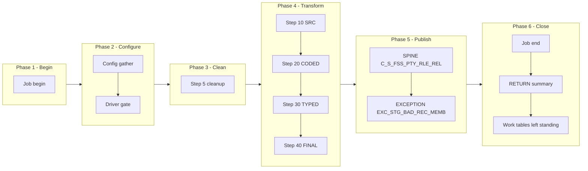

# REL Manifest -- m_Tgt_C_S_FSS_Pty_Rle_Rel, config-driven step-driver refactor (FSS ONLY)

Prefix: `FSS_REL`, short: `REL`. Base dir: `snowflake_all_drivers/FSS/`.
Source verified against: `snowflake_multisource/FSS/mappings/sp_snow_main_m_Tgt_C_S_FSS_Pty_Rle_Rel.sql`
(step map `snowflake_multisource/FSS/STEP_MAP_FSS.md` agrees with the file on
step numbers, work tables and publish counts; where they agreed, no
discrepancy was found -- see Deviations).

## Driver

Signature (IDENTICAL to the current main, verified by normalised comparison):

```sql
sp_snow_main_Tgt_C_S_FSS_Pty_Rle_Rel (
    
        P_JOB_RUN_ID             VARCHAR DEFAULT NULL
) RETURNS VARCHAR
```

File: `drivers/driver_sp_snow_main_Tgt_C_S_FSS_Pty_Rle_Rel.sql`

Driver behaviour: job-run-id generation exactly as now + `sp_etl_job_begin`;
one config GATHER (nested `BEGIN/EXCEPTION`, defaults stand on failure) from
`COMMON.ETL_RUN_CONFIG_TBL` (`WORKFLOW_NAME = 'wf_FSS_Stage_Load'`,
`MAPPING_NAME = 'm_Tgt_C_S_FSS_Pty_Rle_Rel'`); driver-row `STEP_NO = 0` = `'N'` skips the
whole mapping BEFORE step 5 cleanup (SKIPPED checkpoint `MAPPING_SKIPPED`,
`sp_etl_job_finish` with a skipped message, early RETURN); step 5 cleanup
unchanged (bare `DROP TABLE IF EXISTS`, no checkpoint); conditional step
calls in order; ONE publish transaction calling the enabled branch procs in
order; branch checkpoints ONLY after `COMMIT`; `TERMINATING` via
`sp_etl_job_finish` with the same message style and RETURN format as now;
exception block identical in shape (ROLLBACK + TERMINATING `JOB_END`
FAILED checkpoint in the v2 10-argument form + `sp_etl_job_fail` + RAISE).

## Steps

| STEP_NO | Proc | Kind | Produces | Consumes default | Original params used | Checkpoint STEP_NAME | Description |
|---|---|---|---|---|---|---|---|
| 10 | `sp_snow_step_FSS_REL_S10_SRC` | TRANSFORM | `WRK_FSS_REL_S1_SRC` | `` | none | `SRC_ACTIVE` | Source relationships, both parties off the deactivation list |
| 20 | `sp_snow_step_FSS_REL_S20_CODED` | TRANSFORM | `WRK_FSS_REL_S2_CODED` | `WRK_FSS_REL_S1_SRC` | none | `CODED` | Relationship code built (missing code defaults to CAREGIVER), direction code type, output gender, both role keys |
| 30 | `sp_snow_step_FSS_REL_S30_TYPED` | TRANSFORM | `WRK_FSS_REL_S3_TYPED` | `WRK_FSS_REL_S2_CODED` | none | `TYPED` | Relationship code translated through the code-value lookup |
| 40 | `sp_snow_step_FSS_REL_S40_FINAL` | TRANSFORM | `WRK_FSS_REL_S4_FINAL` | `WRK_FSS_REL_S3_TYPED` | none | `FINAL` | Relationship key, constants, exception details, insert-only guards |

Step proc signatures: the step's used original params (in original order) +
`P_JOB_RUN_ID` + `P_RUN_TS` + `P_INPUT_TABLES VARCHAR DEFAULT '<consumes default>'`.
Where an original param carries a default before the trailing params, the
trailing params carry DEFAULT NULL (ECI v2.1 live-compile fix -- never a
required parameter after an optional one; drivers pass everything
positionally, so behaviour is unchanged). Every step proc returns `NUMBER`
(row count), writes its own checkpoint in the v2 10-argument form
(TARGET_TABLE NULL, as in the current main's step checkpoints; row count
survives in the RETURN value and the helper36 summary line), has no
exception block, no transaction, no target write, and starts with the
work-table existence check (skipped when `P_INPUT_TABLES` is NULL/empty).
`P_INPUT_TABLES` is a dependency declaration + runtime check, NOT dynamic
SQL -- each CTAS still names its source work table literally.

Step files: `steps/sp_snow_step_FSS_REL_S<nn>_<NAME>.sql` (4 files).

## Publish branches

Original publish was one step 50 with 2 INSERT(s) in one transaction. Each
INSERT is now one branch proc, called by the driver inside ONE transaction
in the same order, checkpointed by the driver only after COMMIT. First
branch takes step number 50, +10 per branch.

| STEP_NO | Proc | Kind | Target | Consumes | Description | Checkpoint STEP_NAME |
|---|---|---|---|---|---|---|
| 50 | `sp_snow_pub_FSS_REL_C_S_FSS_PTY_RLE_REL` | SPINE | `C_S_FSS_PTY_RLE_REL` | `WRK_FSS_REL_S4_FINAL` | `Valid relationships` | `PUBLISH_C_S_FSS_PTY_RLE_REL` |
| 60 | `sp_snow_pub_FSS_REL_EXC_STG_BAD_REC_MEMB` | EXCEPTION | `EXC_STG_BAD_REC_MEMB` | `WRK_FSS_REL_S4_FINAL` | `Untranslated relationships` | `PUBLISH_EXC` |

Branch proc signatures: `P_JOB_RUN_ID VARCHAR` + `P_RUN_TS TIMESTAMP_NTZ` +
`P_INPUT_TABLES VARCHAR DEFAULT '<last step work table>'`. Each returns
`SQLROWCOUNT` as `NUMBER`. No transaction control, no checkpoint calls.

Branch files: `publish/sp_snow_pub_FSS_REL_<TARGET>[_<BRANCH>].sql` (2 files).

## Preserved quirks (business logic NOT fixed)

- Insert-only: no TRUNCATE, no DELETE of targets. The IDQ truncate of the relationship table is NOT performed; keys already present are skipped instead (uq_rel guard).
- PRESERVED: an untranslated relationship is logged with the looked-up exception code, which is NULL when the 'Invalid_Relationship' code is not configured in the exception catalogue.
- PRESERVED: the direction rule -- 'To Child' rows use the related party's gender and code type REL_TP, other rows use the party's own gender and code type INVERSE_REL -- exactly as in the original.
- Version sequence is 1 and the period start date is the relationship create date, exactly as in the original.

## Phase-flow diagram



Publish is ONE transaction: all branches sit inside the single Publish
subgraph above (groups distinguished by the SPINE / STATUS / EXCEPTION /
VALIDATION label prefixes), never split across subgraphs.

## Verification performed (no live Snowflake available)

- All 4 step CTAS compared to the current file after whitespace normalisation
  and the allowed substitutions only (`:l_run_ts` -> `:P_RUN_TS`,
  `:c_mapping` -> the local constant of the same value): all MATCH.
- All 2 branch INSERTs compared likewise: all MATCH.
- Driver name/signature compared to the current main (normalised): IDENTICAL.
- Counts: 1 driver + 4 step procs + 2 branch procs = 7 files, covering all
  current steps and all current publish INSERTs exactly once.
- Style greps (code lines): 0 `DROPPED` checkpoint calls, 0 `P_RESUME_STEP`,
  0 cursors, 0 `sp_etl_checkpoint` calls and 0 transaction statements in
  publish-branch code, 0 checkpoint calls between the driver's
  `BEGIN TRANSACTION` and `COMMIT`, `TRANSIENT` work tables only with
  unchanged names, `P_JOB_RUN_ID` in every new proc.
- No live Snowflake compile, run, or row-count parity run was possible in
  this environment; that step is required before use.

## Deviations / uncertainties -- nothing silently shipped

1. **Combined publish checkpoint split (by design, per brief).** The current
   file writes ONE step-50 `PUBLISH` checkpoint with the summed row count.
   The refactor writes one checkpoint per branch (STEP_NOs 50, 60, ... in
   order) with that branch's count, plus a per-branch helper36 summary line
   instead of the single `step 50 PUBLISH` line. Total published rows are
   recoverable by summing the branch counts; there is no longer a single
   combined publish row.
2. **Config columns not read.** `IS_DEPENDENT`, `DEPENDENT_ON` and
   `WORK_TABLES_PRODUCED` exist in `ETL_RUN_CONFIG_TBL` but are not read by
   this driver; gating is by `IS_RUN_ENABLED` only, per the brief.
3. **No cascade on skip.** Skipping is per step/branch only. If an upstream
   step is disabled but a downstream step stays enabled, the downstream
   step's existence check raises the missing work table rather than running
   on stale data. Operators must disable downstream steps explicitly.
4. **'SKIPPED' status is a choice to confirm.** `JOB_CONTROL_ETL.STEP_STATUS`
   has no CHECK constraint (only a DDL comment listing
   STARTED | COMPLETED | FAILED); `SKIPPED` rows are used here as specified
   and should be confirmed by the user.
5. **Compile-time verification items (no live Snowflake here).**
   - `l_rows := (CALL proc(...));` scalar-call capture form.
   - `IF` blocks inside the driver's `BEGIN TRANSACTION` / `COMMIT` region
     (branch CALLs gated by flags), and the multi-variable
     `SELECT ... INTO :a, :b, ...` in the GATHER.
   - Unused-parameter warnings, if any, for `P_RUN_TS` in steps/branches
     where it is carried for signature uniformity.
6. **Scope.** FSS `m_Tgt_C_S_FSS_Pty_Rle_Rel` only, as part of the all-sources
   step-driver package. No other source or mapping was touched; the
   current main file was not modified.
