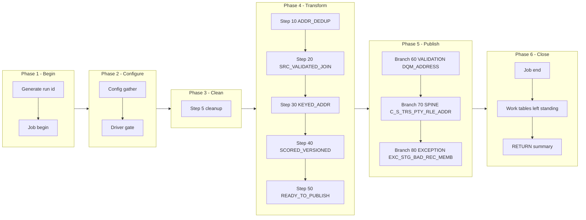

# ADDR2 Manifest — m_Tgt_C_S_TRS_Addr_2, config-driven step-driver refactor (TRS)

Prefix: `TRS_ADDR2` (short: `ADDR2`). Workflow: `wf_TRS_Stage_Load_1_Ongoing`.
Baseline (read-only, never modified): `snowflake_multisource/TRS/mappings/sp_snow_main_m_Tgt_C_S_TRS_Addr_2.sql`.
Driver file: `drivers/driver_sp_snow_main_m_Tgt_C_S_TRS_Addr_2.sql`.

## Driver

Signature (IDENTICAL to the current main, verified by normalised comparison):

```sql
sp_snow_main_m_Tgt_C_S_TRS_Addr_2 (

    P_MEMBER_ROLE_TYPE      VARCHAR DEFAULT 'Member',
    P_MEMBER_HIERARCHY_CODE VARCHAR DEFAULT 'Member',
    P_MEMBER_HM_REL_TP_CD   VARCHAR DEFAULT 'Member Addr',
    P_JOB_RUN_ID            VARCHAR DEFAULT NULL

) RETURNS VARCHAR
```

Driver behaviour: job-run-id generation exactly as now + `sp_etl_job_begin`;
one config GATHER (nested `BEGIN/EXCEPTION`, defaults stand on failure) from
`COMMON.ETL_RUN_CONFIG_TBL` (`WORKFLOW_NAME = 'wf_TRS_Stage_Load_1_Ongoing'`,
`MAPPING_NAME = 'm_Tgt_C_S_TRS_Addr_2'`); driver-row `STEP_NO = 0` = `'N'` skips the
whole mapping BEFORE step 5 cleanup (SKIPPED checkpoint `MAPPING_SKIPPED`,
`sp_etl_job_finish` with a skipped message, early RETURN); step 5 cleanup
unchanged (5 bare `DROP TABLE IF EXISTS`, no checkpoint); conditional step
calls in order; ONE publish transaction calling the enabled branch procs in
order; branch checkpoints ONLY after `COMMIT`; `TERMINATING` via
`sp_etl_job_finish` with the same message style and RETURN format as now;
exception block identical in shape (ROLLBACK + TERMINATING `JOB_END`
FAILED checkpoint in the 10-argument form + `sp_etl_job_fail` + RAISE).

## Steps

| STEP_NO | Proc | Kind | Checkpoint STEP_NAME | Produces | Consumes default | DEPENDENT_ON | Original params used |
|---|---|---|---|---|---|---|---|
| 10 | `sp_snow_step_TRS_ADDR2_S10_DEDUP` | TRANSFORM | `ADDR_DEDUP` | `WRK_TRS_ADDR2_S10_DEDUP` | (base tables only) | — | none |
| 20 | `sp_snow_step_TRS_ADDR2_S20_SRC` | TRANSFORM | `SRC_VALIDATED_JOIN` | `WRK_TRS_ADDR2_S20_SRC` | WRK_TRS_ADDR2_S10_DEDUP | 10 | none |
| 30 | `sp_snow_step_TRS_ADDR2_S30_KEYED` | TRANSFORM | `KEYED_ADDR` | `WRK_TRS_ADDR2_S30_KEYED` | WRK_TRS_ADDR2_S20_SRC | 20 | P_MEMBER_ROLE_TYPE |
| 40 | `sp_snow_step_TRS_ADDR2_S40_SCORED` | TRANSFORM | `SCORED_VERSIONED` | `WRK_TRS_ADDR2_S40_SCORED` | WRK_TRS_ADDR2_S30_KEYED | 30 | none |
| 50 | `sp_snow_step_TRS_ADDR2_S50_READY` | TRANSFORM | `READY_TO_PUBLISH` | `WRK_TRS_ADDR2_S50_READY` | WRK_TRS_ADDR2_S40_SCORED | 40 | P_MEMBER_ROLE_TYPE, P_MEMBER_HIERARCHY_CODE, P_MEMBER_HM_REL_TP_CD |

Step proc signatures: the step's used original params (in original order) +
`P_JOB_RUN_ID VARCHAR DEFAULT NULL` + `P_RUN_TS TIMESTAMP_NTZ DEFAULT NULL`
+ `P_INPUT_TABLES VARCHAR DEFAULT '<consumes default>'`. Every step proc
returns `NUMBER` (row count), writes its own checkpoint in the 10-argument
form (`P_SOURCE, P_JOB_RUN_ID, P_WORKFLOW_NAME, P_MAPPING_NAME, P_STATE,
P_STEP_NAME, P_STEP_STATUS, P_TARGET_TABLE, P_MESSAGE, P_ERROR_MESSAGE`),
has no exception block, no transaction, no target write, and starts with
the work-table existence check (skipped when `P_INPUT_TABLES` is
NULL/empty; the probe surfaces the native missing-table error because
RAISE cannot carry a dynamic table name). `P_INPUT_TABLES` is a dependency
declaration + runtime check, NOT dynamic SQL — each CTAS still names its
source work table literally.

Step files: `steps/sp_snow_step_TRS_ADDR2_S<nn>_<NAME>.sql` (5 files).

## Publish branches

Original publish was one step 60 with 3 INSERTs in one transaction. Each
INSERT is now one branch proc, called by the driver inside ONE transaction
in the same order, checkpointed by the driver only after COMMIT. All
branches stay inside a SINGLE Publish subgraph in the diagram below;
spine / status / exception groups are distinguished by label prefixes
inside that subgraph, never by splitting the transaction.

| STEP_NO | Proc | Kind | Target | Consumes | DEPENDENT_ON | Original params used |
|---|---|---|---|---|---|---|
| 60 | `sp_snow_pub_TRS_ADDR2_DQM_ADDRESS` | VALIDATION | `DQM_ADDRESS` | WRK_TRS_ADDR2_S50_READY | 50 | none |
| 70 | `sp_snow_pub_TRS_ADDR2_C_S_TRS_PTY_RLE_ADDR` | SPINE | `C_S_TRS_PTY_RLE_ADDR` | WRK_TRS_ADDR2_S50_READY | 50 | none |
| 80 | `sp_snow_pub_TRS_ADDR2_EXC_STG_BAD_REC_MEMB` | EXCEPTION | `EXC_STG_BAD_REC_MEMB` | WRK_TRS_ADDR2_S50_READY | 50 | none |

Branch proc signatures: the branch INSERT's used original params (in
original order) + `P_JOB_RUN_ID VARCHAR DEFAULT NULL` +
`P_RUN_TS TIMESTAMP_NTZ DEFAULT NULL` +
`P_INPUT_TABLES VARCHAR DEFAULT '<consumes default>'`. Each returns
`SQLROWCOUNT` as `NUMBER`. No transaction control, no checkpoint calls.
Driver checkpoint STEP_NAMEs are the `PUBLISH_*` names in the table above.

Branch files: `publish/sp_snow_pub_TRS_ADDR2_<TARGET>[_<BRANCH>].sql` (3 files).

## Preserved quirks (verbatim substance from the current main header)

(kept deliberately, do not "fix" silently)
  * Insert-only, as in the original Snowflake code: no TRUNCATE, no
    DELETE of targets.  IDQ truncates C_S_TRS_PTY_RLE_ADDR first; the
    Snowflake version instead skips keys already present (the uq_addr
    guard in step 50, on PKEY_SRC_OBJECT + VERSION_SEQ, and the
    uq_addr_exc guard for exceptions).  A re-run therefore inserts
    nothing twice, but it also does not remove rows that IDQ would
    have truncated away -- see the User Guide, "Parity gaps".
  * Score rules, exactly as in the original: only '100' loads and only
    '40' is exceptioned.  The IDQ Default router branch is not linked
    ("the score is always '40' or '100"), so a row with any other
    score is written to DQM_ADDRESS (the WHEN TRUE audit branch) and
    to neither staging nor exceptions.  That behaviour is preserved
    here; if a new score ever appears, it will be visible in
    DQM_ADDRESS and nowhere else, which is the signal to revisit it.
  * 50-year rule quirk, preserved: fn_snow_helper21_common reproduces
    the IDQ comparison of the year difference as TEXT with '50', so
    end dates more than 50 years away AND end dates 6 to 10 years away
    become NULL (open).  Do not "correct" this helper without also
    changing the business rule, because PERIOD_END_DATE and EFF_END_DT
    both carry its result.
  * The source's "select distinct" flag is ignored by IDQ when custom
    SQL is used, so it is not applied here either, as in the original.
  * Unfed ports written as NULL, as in the original: ROWID_OBJECT,
    DELETED_*, UPDATED_BY, HUB_STATE_IND, USG_TP, CRDNT_SYS, PSTL_BRCD,
    RGN_CD, CREATOR, CREATE_DATE, LCTN_CRDNT_DESC (sorter port without
    input -- note step 50 does populate LOC_IDN from CASE_NUM/EDG_NUM).
  * PERIOD_REFERENCE_TIME = run start when EFF_END_DT is set, else NULL.
  * VERSION_SEQ is a running number per role-address key in (key,
    SRC_LAST_UPDATE_DATE desc, EFF_END_DT desc, EFF_BEGIN_DT desc;
    NULL high) order -- every row is written, numbered 1, 2, 3, ...
    within the key.  SRC_ROWID = key || '|' || VERSION_SEQ.

## Verification performed (no live Snowflake available)

- Step CTAS compared to the current file after whitespace normalisation
  and the allowed substitutions only (`:l_run_ts` -> `:P_RUN_TS`,
  `:c_mapping` -> the local constant of the same value): all MATCH.
- Branch INSERTs compared likewise: all MATCH.
- Driver name/signature compared to the current main (normalised): IDENTICAL.
- Counts: 1 driver + 5 step procs + 3 branch procs, covering all 5
  current steps and all 3 current publish INSERTs exactly once.
- Style greps: 0 `DROPPED` checkpoint calls, 0 `P_RESUME_STEP`,
  0 cursors in code, 0 `sp_etl_checkpoint` calls and 0 transaction
  statements in publish-branch code, 0 checkpoint calls between the
  driver's `BEGIN TRANSACTION` and `COMMIT`, `TRANSIENT` work tables
  only with unchanged names, `P_JOB_RUN_ID` in every new proc.
- No live Snowflake compile, run, or row-count parity run was possible
  in this environment; that step is required before use.

## Phase-flow diagram


