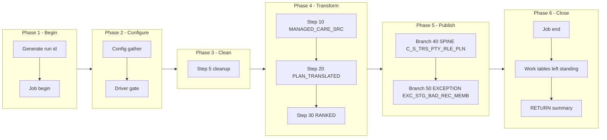

# PLN Manifest — m_Tgt_C_S_TRS_Pty_Rle_Pln, config-driven step-driver refactor (TRS)

Prefix: `TRS_PLN` (short: `PLN`). Workflow: `wf_TRS_Stage_Load_1_Ongoing`.
Baseline (read-only, never modified): `snowflake_multisource/TRS/mappings/sp_snow_main_m_Tgt_C_S_TRS_Pty_Rle_Pln.sql`.
Driver file: `drivers/driver_sp_snow_main_m_Tgt_C_S_TRS_Pty_Rle_Pln.sql`.

## Driver

Signature (IDENTICAL to the current main, verified by normalised comparison):

```sql
sp_snow_main_m_Tgt_C_S_TRS_Pty_Rle_Pln (

    P_JOB_RUN_ID  VARCHAR DEFAULT NULL

) RETURNS VARCHAR
```

Driver behaviour: job-run-id generation exactly as now + `sp_etl_job_begin`;
one config GATHER (nested `BEGIN/EXCEPTION`, defaults stand on failure) from
`COMMON.ETL_RUN_CONFIG_TBL` (`WORKFLOW_NAME = 'wf_TRS_Stage_Load_1_Ongoing'`,
`MAPPING_NAME = 'm_Tgt_C_S_TRS_Pty_Rle_Pln'`); driver-row `STEP_NO = 0` = `'N'` skips the
whole mapping BEFORE step 5 cleanup (SKIPPED checkpoint `MAPPING_SKIPPED`,
`sp_etl_job_finish` with a skipped message, early RETURN); step 5 cleanup
unchanged (3 bare `DROP TABLE IF EXISTS`, no checkpoint); conditional step
calls in order; ONE publish transaction calling the enabled branch procs in
order; branch checkpoints ONLY after `COMMIT`; `TERMINATING` via
`sp_etl_job_finish` with the same message style and RETURN format as now;
exception block identical in shape (ROLLBACK + TERMINATING `JOB_END`
FAILED checkpoint in the 10-argument form + `sp_etl_job_fail` + RAISE).

## Steps

| STEP_NO | Proc | Kind | Checkpoint STEP_NAME | Produces | Consumes default | DEPENDENT_ON | Original params used |
|---|---|---|---|---|---|---|---|
| 10 | `sp_snow_step_TRS_PLN_S10_SRC` | TRANSFORM | `MANAGED_CARE_SRC` | `WRK_TRS_PLN_S10_SRC` | (base tables only) | — | none |
| 20 | `sp_snow_step_TRS_PLN_S20_PLANNED` | TRANSFORM | `PLAN_TRANSLATED` | `WRK_TRS_PLN_S20_PLANNED` | WRK_TRS_PLN_S10_SRC | 10 | none |
| 30 | `sp_snow_step_TRS_PLN_S30_RANKED` | TRANSFORM | `RANKED` | `WRK_TRS_PLN_S30_RANKED` | WRK_TRS_PLN_S20_PLANNED | 20 | none |

Step proc signatures: the step's used original params (in original order) +
`P_JOB_RUN_ID VARCHAR DEFAULT NULL` + `P_RUN_TS TIMESTAMP_NTZ DEFAULT NULL`
+ `P_INPUT_TABLES VARCHAR DEFAULT '<consumes default>'`. Every step proc
returns `NUMBER` (row count), writes its own checkpoint in the 10-argument
form (`P_SOURCE, P_JOB_RUN_ID, P_WORKFLOW_NAME, P_MAPPING_NAME, P_STATE,
P_STEP_NAME, P_STEP_STATUS, P_TARGET_TABLE, P_MESSAGE, P_ERROR_MESSAGE`),
has no exception block, no transaction, no target write, and starts with
the work-table existence check (skipped when `P_INPUT_TABLES` is
NULL/empty; the probe surfaces the native missing-table error because
RAISE cannot carry a dynamic table name). `P_INPUT_TABLES` is a dependency
declaration + runtime check, NOT dynamic SQL — each CTAS still names its
source work table literally.

Step files: `steps/sp_snow_step_TRS_PLN_S<nn>_<NAME>.sql` (3 files).

## Publish branches

Original publish was one step 40 with 2 INSERTs in one transaction. Each
INSERT is now one branch proc, called by the driver inside ONE transaction
in the same order, checkpointed by the driver only after COMMIT. All
branches stay inside a SINGLE Publish subgraph in the diagram below;
spine / status / exception groups are distinguished by label prefixes
inside that subgraph, never by splitting the transaction.

| STEP_NO | Proc | Kind | Target | Consumes | DEPENDENT_ON | Original params used |
|---|---|---|---|---|---|---|
| 40 | `sp_snow_pub_TRS_PLN_C_S_TRS_PTY_RLE_PLN` | SPINE | `C_S_TRS_PTY_RLE_PLN` | WRK_TRS_PLN_S30_RANKED | 30 | none |
| 50 | `sp_snow_pub_TRS_PLN_EXC_STG_BAD_REC_MEMB` | EXCEPTION | `EXC_STG_BAD_REC_MEMB` | WRK_TRS_PLN_S30_RANKED | 30 | none |

Branch proc signatures: the branch INSERT's used original params (in
original order) + `P_JOB_RUN_ID VARCHAR DEFAULT NULL` +
`P_RUN_TS TIMESTAMP_NTZ DEFAULT NULL` +
`P_INPUT_TABLES VARCHAR DEFAULT '<consumes default>'`. Each returns
`SQLROWCOUNT` as `NUMBER`. No transaction control, no checkpoint calls.
Driver checkpoint STEP_NAMEs are the `PUBLISH_*` names in the table above.

Branch files: `publish/sp_snow_pub_TRS_PLN_<TARGET>[_<BRANCH>].sql` (2 files).

## Preserved quirks (verbatim substance from the current main header)

(kept deliberately, do not "fix" silently)
  * Insert-only, as in the original Snowflake code: no TRUNCATE, no
    DELETE of the targets.  IDQ truncates C_S_TRS_PTY_RLE_PLN; the
    Snowflake version instead skips keys already present (the
    existing-key guard in step 30) and keeps the last row per key in
    this run.  A re-run therefore inserts nothing twice, but it also
    does not remove rows that IDQ would have truncated away -- see
    the User Guide, "Parity gaps".
  * Rows whose begin date is NOT before the end date (including
    begin = end) are dropped by the step-10 source filter, silently:
    they are neither loaded nor exceptioned, exactly as in the
    original.  Open-ended rows (END_DT IS NULL) do load.
  * The plan lookup is under source system 'MAX', not 'TRS', as in the
    original -- preserved, not "corrected".
  * VERSION_SEQ is hard-coded to 1; PERIOD_START_DATE / PERIOD_END_DATE
    = BEGIN_DT / END_DT of the last (latest) segment of the key.
  * UPDATED_BY, CREATOR, HUB_STATE_IND, ROWID_OBJECT and DELETED_*
    are NULL (unfed ports), as in the original.

## Verification performed (no live Snowflake available)

- Step CTAS compared to the current file after whitespace normalisation
  and the allowed substitutions only (`:l_run_ts` -> `:P_RUN_TS`,
  `:c_mapping` -> the local constant of the same value): all MATCH.
- Branch INSERTs compared likewise: all MATCH.
- Driver name/signature compared to the current main (normalised): IDENTICAL.
- Counts: 1 driver + 3 step procs + 2 branch procs, covering all 3
  current steps and all 2 current publish INSERTs exactly once.
- Style greps: 0 `DROPPED` checkpoint calls, 0 `P_RESUME_STEP`,
  0 cursors in code, 0 `sp_etl_checkpoint` calls and 0 transaction
  statements in publish-branch code, 0 checkpoint calls between the
  driver's `BEGIN TRANSACTION` and `COMMIT`, `TRANSIENT` work tables
  only with unchanged names, `P_JOB_RUN_ID` in every new proc.
- No live Snowflake compile, run, or row-count parity run was possible
  in this environment; that step is required before use.

## Phase-flow diagram


