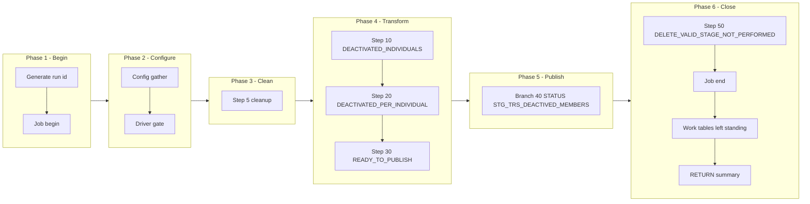

# PTYDEACT Manifest — m_Tgt_C_S_TRS_Pty_Deactivation_1, config-driven step-driver refactor (TRS)

Prefix: `TRS_PTYDEACT` (short: `PTYDEACT`). Workflow: `wf_TRS_Stage_Load_1_Ongoing`.
Baseline (read-only, never modified): `snowflake_multisource/TRS/mappings/sp_snow_main_m_Tgt_C_S_TRS_Pty_Deactivation_1.sql`.
Driver file: `drivers/driver_sp_snow_main_m_Tgt_C_S_TRS_Pty_Deactivation_1.sql`.

## Driver

Signature (IDENTICAL to the current main, verified by normalised comparison):

```sql
sp_snow_main_m_Tgt_C_S_TRS_Pty_Deactivation_1 (

    P_JOB_RUN_ID  VARCHAR DEFAULT NULL

) RETURNS VARCHAR
```

Driver behaviour: job-run-id generation exactly as now + `sp_etl_job_begin`;
one config GATHER (nested `BEGIN/EXCEPTION`, defaults stand on failure) from
`COMMON.ETL_RUN_CONFIG_TBL` (`WORKFLOW_NAME = 'wf_TRS_Stage_Load_1_Ongoing'`,
`MAPPING_NAME = 'm_Tgt_C_S_TRS_Pty_Deactivation_1'`); driver-row `STEP_NO = 0` = `'N'` skips the
whole mapping BEFORE step 5 cleanup (SKIPPED checkpoint `MAPPING_SKIPPED`,
`sp_etl_job_finish` with a skipped message, early RETURN); step 5 cleanup
unchanged (3 bare `DROP TABLE IF EXISTS`, no checkpoint); conditional step
calls in order; ONE publish transaction calling the enabled branch procs in
order; branch checkpoints ONLY after `COMMIT`; `TERMINATING` via
`sp_etl_job_finish` with the same message style and RETURN format as now;
exception block identical in shape (ROLLBACK + TERMINATING `JOB_END`
FAILED checkpoint in the 10-argument form + `sp_etl_job_fail` + RAISE).

## Post-publish record step (not a data step)

| STEP_NO | Proc | Kind | Checkpoint | Target | Consumes | DEPENDENT_ON |
|---|---|---|---|---|---|---|
| 50 | `sp_snow_step_TRS_PTYDEACT_S50_NOTPERFORMED` | STATUS | `DELETE_VALID_STAGE_NOT_PERFORMED` | `STG_TRS_VALID_MEMBERS` | (none) | 40 |

This step writes NO data. It is called by the driver AFTER the publish
transaction has committed, because that is the original step order
(publish 40, then this record 50). It exists only so the deliberate
non-delete stays visible in JOB_CONTROL_ETL. If its config row is 'N',
the driver writes a SKIPPED checkpoint instead; it never blocks publish.

## Steps

| STEP_NO | Proc | Kind | Checkpoint STEP_NAME | Produces | Consumes default | DEPENDENT_ON | Original params used |
|---|---|---|---|---|---|---|---|
| 10 | `sp_snow_step_TRS_PTYDEACT_S10_DEACTV` | TRANSFORM | `DEACTIVATED_INDIVIDUALS` | `WRK_TRS_DEACT1_S10_DEACTV` | (base tables only) | — | none |
| 20 | `sp_snow_step_TRS_PTYDEACT_S20_DEACTV_ID` | TRANSFORM | `DEACTIVATED_PER_INDIVIDUAL` | `WRK_TRS_DEACT1_S20_DEACTV_ID` | WRK_TRS_DEACT1_S10_DEACTV | 10 | none |
| 30 | `sp_snow_step_TRS_PTYDEACT_S30_READY` | TRANSFORM | `READY_TO_PUBLISH` | `WRK_TRS_DEACT1_S30_READY` | WRK_TRS_DEACT1_S20_DEACTV_ID | 20 | none |

Step proc signatures: the step's used original params (in original order) +
`P_JOB_RUN_ID VARCHAR DEFAULT NULL` + `P_RUN_TS TIMESTAMP_NTZ DEFAULT NULL`
+ `P_INPUT_TABLES VARCHAR DEFAULT '<consumes default>'`. Every step proc
returns `NUMBER` (row count), writes its own checkpoint in the 10-argument
form (`P_SOURCE, P_JOB_RUN_ID, P_WORKFLOW_NAME, P_MAPPING_NAME, P_STATE,
P_STEP_NAME, P_STEP_STATUS, P_TARGET_TABLE, P_MESSAGE, P_ERROR_MESSAGE`),
has no exception block, no transaction, no target write, and starts with
the work-table existence check (skipped when `P_INPUT_TABLES` is
NULL/empty; the probe surfaces the native missing-table error because
RAISE cannot carry a dynamic table name). `P_INPUT_TABLES` is a dependency
declaration + runtime check, NOT dynamic SQL — each CTAS still names its
source work table literally.

Step files: `steps/sp_snow_step_TRS_PTYDEACT_S<nn>_<NAME>.sql` (4 files).

## Publish branches

Original publish was one step 40 with 1 INSERTs in one transaction. Each
INSERT is now one branch proc, called by the driver inside ONE transaction
in the same order, checkpointed by the driver only after COMMIT. All
branches stay inside a SINGLE Publish subgraph in the diagram below;
spine / status / exception groups are distinguished by label prefixes
inside that subgraph, never by splitting the transaction.

| STEP_NO | Proc | Kind | Target | Consumes | DEPENDENT_ON | Original params used |
|---|---|---|---|---|---|---|
| 40 | `sp_snow_pub_TRS_PTYDEACT_STG_TRS_DEACTIVED_MEMBERS` | STATUS | `STG_TRS_DEACTIVED_MEMBERS` | WRK_TRS_DEACT1_S30_READY | 30 | none |

Branch proc signatures: the branch INSERT's used original params (in
original order) + `P_JOB_RUN_ID VARCHAR DEFAULT NULL` +
`P_RUN_TS TIMESTAMP_NTZ DEFAULT NULL` +
`P_INPUT_TABLES VARCHAR DEFAULT '<consumes default>'`. Each returns
`SQLROWCOUNT` as `NUMBER`. No transaction control, no checkpoint calls.
Driver checkpoint STEP_NAMEs are the `PUBLISH_*` names in the table above.

Branch files: `publish/sp_snow_pub_TRS_PTYDEACT_<TARGET>[_<BRANCH>].sql` (1 files).

## Preserved quirks (verbatim substance from the current main header)

(kept deliberately, do not "fix" silently)
  * Insert-only, as in the original Snowflake code: no TRUNCATE, no
    DELETE of targets.  In particular, the IDQ DD_DELETE of
    STG_TRS_VALID_MEMBERS is NOT performed here (step 50).  That means
    deactivated members STAY in the valid-member list in the Snowflake
    version, whereas IDQ removes them -- so downstream Snowflake
    mappings that join STG_TRS_VALID_MEMBERS will still see
    deactivated members until some other process removes them.  This
    is the single largest parity gap in this mapping, and it is a
    business decision, not a bug to fix in passing: the original
    Snowflake comment cites it as a deliberate insert-only rule.
  * STG_TRS_DEACTIVED_MEMBERS has primary key INDV_ID, which Snowflake
    does not enforce.  An individual can be a valid member under two
    party keys (INDV_ID|DC_INDV and INDV_ID for MCI); IDQ writes the
    first and the database rejects the second.  Reproduced here: one
    row per INDV_ID (step 30 rank), and IDs already in the table are
    skipped (di guard), as well as party keys already logged (dm guard).
  * LOAD_DATE = run start (:l_run_ts), PROCESSED_YN = 'N' for every
    new log row, as in the original.

## Verification performed (no live Snowflake available)

- Step CTAS compared to the current file after whitespace normalisation
  and the allowed substitutions only (`:l_run_ts` -> `:P_RUN_TS`,
  `:c_mapping` -> the local constant of the same value): all MATCH.
- Branch INSERTs compared likewise: all MATCH.
- Driver name/signature compared to the current main (normalised): IDENTICAL.
- Counts: 1 driver + 4 step procs + 1 branch procs, covering all 4
  current steps and all 1 current publish INSERTs exactly once.
- Style greps: 0 `DROPPED` checkpoint calls, 0 `P_RESUME_STEP`,
  0 cursors in code, 0 `sp_etl_checkpoint` calls and 0 transaction
  statements in publish-branch code, 0 checkpoint calls between the
  driver's `BEGIN TRANSACTION` and `COMMIT`, `TRANSIENT` work tables
  only with unchanged names, `P_JOB_RUN_ID` in every new proc.
- No live Snowflake compile, run, or row-count parity run was possible
  in this environment; that step is required before use.

## Phase-flow diagram


