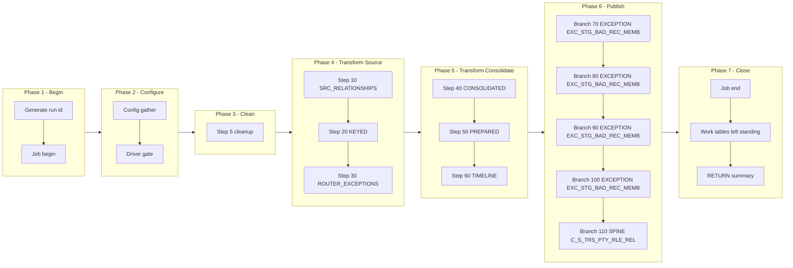

# REL1 Manifest — m_Tgt_C_S_TRS_Pty_Rle_Rel_1_Mem_To_Mem, config-driven step-driver refactor (TRS)

Prefix: `TRS_REL1` (short: `REL1`). Workflow: `wf_TRS_Stage_Load_1_Ongoing`.
Baseline (read-only, never modified): `snowflake_multisource/TRS/mappings/sp_snow_main_m_Tgt_C_S_TRS_Pty_Rle_Rel_1_Mem_To_Mem.sql`.
Driver file: `drivers/driver_sp_snow_main_m_Tgt_C_S_TRS_Pty_Rle_Rel_1_Mem_To_Mem.sql`.

## Driver

Signature (IDENTICAL to the current main, verified by normalised comparison):

```sql
sp_snow_main_m_Tgt_C_S_TRS_Pty_Rle_Rel_1_Mem_To_Mem (

    P_INDV_ID_ALT_ID_TP VARCHAR DEFAULT '007',  -- $INDV_ID_ALT_ID_TP (substituted into the source SQL)
    P_JOB_RUN_ID             VARCHAR DEFAULT NULL

) RETURNS VARCHAR
```

Driver behaviour: job-run-id generation exactly as now + `sp_etl_job_begin`;
one config GATHER (nested `BEGIN/EXCEPTION`, defaults stand on failure) from
`COMMON.ETL_RUN_CONFIG_TBL` (`WORKFLOW_NAME = 'wf_TRS_Stage_Load_1_Ongoing'`,
`MAPPING_NAME = 'm_Tgt_C_S_TRS_Pty_Rle_Rel_1_Mem_To_Mem'`); driver-row `STEP_NO = 0` = `'N'` skips the
whole mapping BEFORE step 5 cleanup (SKIPPED checkpoint `MAPPING_SKIPPED`,
`sp_etl_job_finish` with a skipped message, early RETURN); step 5 cleanup
unchanged (6 bare `DROP TABLE IF EXISTS`, no checkpoint); conditional step
calls in order; ONE publish transaction calling the enabled branch procs in
order; branch checkpoints ONLY after `COMMIT`; `TERMINATING` via
`sp_etl_job_finish` with the same message style and RETURN format as now;
exception block identical in shape (ROLLBACK + TERMINATING `JOB_END`
FAILED checkpoint in the 10-argument form + `sp_etl_job_fail` + RAISE).

## Steps

| STEP_NO | Proc | Kind | Checkpoint STEP_NAME | Produces | Consumes default | DEPENDENT_ON | Original params used |
|---|---|---|---|---|---|---|---|
| 10 | `sp_snow_step_TRS_REL1_S10_SRC` | TRANSFORM | `SRC_RELATIONSHIPS` | `WRK_TRS_REL1_S1_SRC` | (base tables only) | — | P_INDV_ID_ALT_ID_TP |
| 20 | `sp_snow_step_TRS_REL1_S20_KEYED` | TRANSFORM | `KEYED` | `WRK_TRS_REL1_S2_KEYED` | WRK_TRS_REL1_S1_SRC | 10 | none |
| 30 | `sp_snow_step_TRS_REL1_S30_ROUTER` | TRANSFORM | `ROUTER_EXCEPTIONS` | `WRK_TRS_REL1_S3_ROUTER` | WRK_TRS_REL1_S2_KEYED | 20 | none |
| 40 | `sp_snow_step_TRS_REL1_S40_CONSOL` | TRANSFORM | `CONSOLIDATED` | `WRK_TRS_REL1_S4_CONSOL` | WRK_TRS_REL1_S2_KEYED | 20 | none |
| 50 | `sp_snow_step_TRS_REL1_S50_PREP` | TRANSFORM | `PREPARED` | `WRK_TRS_REL1_S5_PREP` | WRK_TRS_REL1_S4_CONSOL | 40 | none |
| 60 | `sp_snow_step_TRS_REL1_S60_TIMELINE` | TRANSFORM | `TIMELINE` | `WRK_TRS_REL1_S6_TIMELINE` | WRK_TRS_REL1_S5_PREP | 50 | none |

Step proc signatures: the step's used original params (in original order) +
`P_JOB_RUN_ID VARCHAR DEFAULT NULL` + `P_RUN_TS TIMESTAMP_NTZ DEFAULT NULL`
+ `P_INPUT_TABLES VARCHAR DEFAULT '<consumes default>'`. Every step proc
returns `NUMBER` (row count), writes its own checkpoint in the 10-argument
form (`P_SOURCE, P_JOB_RUN_ID, P_WORKFLOW_NAME, P_MAPPING_NAME, P_STATE,
P_STEP_NAME, P_STEP_STATUS, P_TARGET_TABLE, P_MESSAGE, P_ERROR_MESSAGE`),
has no exception block, no transaction, no target write, and starts with
the work-table existence check (skipped when `P_INPUT_TABLES` is
NULL/empty; the probe surfaces the native missing-table error because
RAISE cannot carry a dynamic table name). `P_INPUT_TABLES` is a dependency
declaration + runtime check, NOT dynamic SQL — each CTAS still names its
source work table literally.

Step files: `steps/sp_snow_step_TRS_REL1_S<nn>_<NAME>.sql` (6 files).

## Publish branches

Original publish was one step 70 with 5 INSERTs in one transaction. Each
INSERT is now one branch proc, called by the driver inside ONE transaction
in the same order, checkpointed by the driver only after COMMIT. All
branches stay inside a SINGLE Publish subgraph in the diagram below;
spine / status / exception groups are distinguished by label prefixes
inside that subgraph, never by splitting the transaction.

| STEP_NO | Proc | Kind | Target | Consumes | DEPENDENT_ON | Original params used |
|---|---|---|---|---|---|---|
| 70 | `sp_snow_pub_TRS_REL1_EXC_STG_BAD_REC_MEMB_MAIN_ALT_ID` | EXCEPTION | `EXC_STG_BAD_REC_MEMB` | WRK_TRS_REL1_S3_ROUTER | 30 | none |
| 80 | `sp_snow_pub_TRS_REL1_EXC_STG_BAD_REC_MEMB_REF_ALT_ID` | EXCEPTION | `EXC_STG_BAD_REC_MEMB` | WRK_TRS_REL1_S3_ROUTER | 30 | none |
| 90 | `sp_snow_pub_TRS_REL1_EXC_STG_BAD_REC_MEMB_LOOKUP` | EXCEPTION | `EXC_STG_BAD_REC_MEMB` | WRK_TRS_REL1_S3_ROUTER | 30 | none |
| 100 | `sp_snow_pub_TRS_REL1_EXC_STG_BAD_REC_MEMB_DATES` | EXCEPTION | `EXC_STG_BAD_REC_MEMB` | WRK_TRS_REL1_S3_ROUTER | 30 | none |
| 110 | `sp_snow_pub_TRS_REL1_C_S_TRS_PTY_RLE_REL` | SPINE | `C_S_TRS_PTY_RLE_REL` | WRK_TRS_REL1_S6_TIMELINE | 60 | none |

Branch proc signatures: the branch INSERT's used original params (in
original order) + `P_JOB_RUN_ID VARCHAR DEFAULT NULL` +
`P_RUN_TS TIMESTAMP_NTZ DEFAULT NULL` +
`P_INPUT_TABLES VARCHAR DEFAULT '<consumes default>'`. Each returns
`SQLROWCOUNT` as `NUMBER`. No transaction control, no checkpoint calls.
Driver checkpoint STEP_NAMEs are the `PUBLISH_*` names in the table above.

Branch files: `publish/sp_snow_pub_TRS_REL1_<TARGET>[_<BRANCH>].sql` (5 files).

## Preserved quirks (verbatim substance from the current main header)

(kept deliberately, do not "fix" silently)
  * Insert-only, as in the original Snowflake code: no TRUNCATE, no
    DELETE of targets.  IDQ truncates C_S_TRS_PTY_RLE_REL; the
    Snowflake version instead skips keys already present (uq_rel).
    A re-run therefore inserts nothing twice, but it also does not
    remove rows that IDQ would have truncated away.
  * Relationship foreign keys are based on source keys, not MDM
    rowids, as in IDQ (keys are '<pty_pk>|Member').
  * 'Invalid_Rel_Type' writes the looked-up code: the exception code
    column in that INSERT is the code row looked up from
    EXC_LOOKUP_CODE_VALUE, so it is NULL when that code is not
    configured in the lookup table -- preserved.
  * Unfed ports written as NULL: ROWID_OBJECT, DELETED_*, UPDATED_BY,
    CREATOR.  HUB_STATE_IND is 1 only on the open row with
    VERSION_SEQ 1 (its input port is not fed, so all other rows
    get NULL); PERIOD_REFERENCE_TIME is the (DST-corrected) end
    date and TIMELINE_ACTION is 2 when end-dated, NULL when open.
  * The timeline changes the ROW SET, not only column values:
    every end-dated row is emitted twice (the closed version and an
    open copy with the end date removed).  That duplication is the
    original behaviour, preserved in step 60.

## Verification performed (no live Snowflake available)

- Step CTAS compared to the current file after whitespace normalisation
  and the allowed substitutions only (`:l_run_ts` -> `:P_RUN_TS`,
  `:c_mapping` -> the local constant of the same value): all MATCH.
- Branch INSERTs compared likewise: all MATCH.
- Driver name/signature compared to the current main (normalised): IDENTICAL.
- Counts: 1 driver + 6 step procs + 5 branch procs, covering all 6
  current steps and all 5 current publish INSERTs exactly once.
- Style greps: 0 `DROPPED` checkpoint calls, 0 `P_RESUME_STEP`,
  0 cursors in code, 0 `sp_etl_checkpoint` calls and 0 transaction
  statements in publish-branch code, 0 checkpoint calls between the
  driver's `BEGIN TRANSACTION` and `COMMIT`, `TRANSIENT` work tables
  only with unchanged names, `P_JOB_RUN_ID` in every new proc.
- No live Snowflake compile, run, or row-count parity run was possible
  in this environment; that step is required before use.

## Phase-flow diagram


