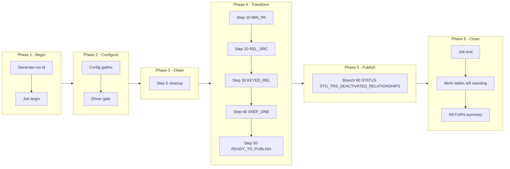

# RELDEACT Manifest — m_Tgt_C_S_TRS_Pty_Rle_Rel_DeActivation_1, config-driven step-driver refactor (TRS)

Prefix: `TRS_RELDEACT` (short: `RELDEACT`). Workflow: `wf_TRS_Stage_Load_1_Ongoing`.
Baseline (read-only, never modified): `snowflake_multisource/TRS/mappings/sp_snow_main_m_Tgt_C_S_TRS_Pty_Rle_Rel_DeActivation_1.sql`.
Driver file: `drivers/driver_sp_snow_main_m_Tgt_C_S_TRS_Pty_Rle_Rel_DeActivation_1.sql`.

## Driver

Signature (IDENTICAL to the current main, verified by normalised comparison):

```sql
sp_snow_main_m_Tgt_C_S_TRS_Pty_Rle_Rel_DeActivation_1 (

    P_JOB_RUN_ID  VARCHAR DEFAULT NULL

) RETURNS VARCHAR
```

Driver behaviour: job-run-id generation exactly as now + `sp_etl_job_begin`;
one config GATHER (nested `BEGIN/EXCEPTION`, defaults stand on failure) from
`COMMON.ETL_RUN_CONFIG_TBL` (`WORKFLOW_NAME = 'wf_TRS_Stage_Load_1_Ongoing'`,
`MAPPING_NAME = 'm_Tgt_C_S_TRS_Pty_Rle_Rel_DeActivation_1'`); driver-row `STEP_NO = 0` = `'N'` skips the
whole mapping BEFORE step 5 cleanup (SKIPPED checkpoint `MAPPING_SKIPPED`,
`sp_etl_job_finish` with a skipped message, early RETURN); step 5 cleanup
unchanged (5 bare `DROP TABLE IF EXISTS`, no checkpoint); conditional step
calls in order; ONE publish transaction calling the enabled branch procs in
order; branch checkpoints ONLY after `COMMIT`; `TERMINATING` via
`sp_etl_job_finish` with the same message style and RETURN format as now;
exception block identical in shape (ROLLBACK + TERMINATING `JOB_END`
FAILED checkpoint in the 10-argument form + `sp_etl_job_fail` + RAISE).

## Steps

| STEP_NO | Proc | Kind | Checkpoint STEP_NAME | Produces | Consumes default | DEPENDENT_ON | Original params used |
|---|---|---|---|---|---|---|---|
| 10 | `sp_snow_step_TRS_RELDEACT_S10_MINPK` | TRANSFORM | `MIN_PK` | `WRK_TRS_RELDEACT_S10_MINPK` | (base tables only) | — | none |
| 20 | `sp_snow_step_TRS_RELDEACT_S20_SRC` | TRANSFORM | `REL_SRC` | `WRK_TRS_RELDEACT_S20_SRC` | WRK_TRS_RELDEACT_S10_MINPK | 10 | none |
| 30 | `sp_snow_step_TRS_RELDEACT_S30_KEYED` | TRANSFORM | `KEYED_REL` | `WRK_TRS_RELDEACT_S30_KEYED` | WRK_TRS_RELDEACT_S20_SRC | 20 | none |
| 40 | `sp_snow_step_TRS_RELDEACT_S40_XREF` | TRANSFORM | `XREF_ONE` | `WRK_TRS_RELDEACT_S40_XREF` | (base tables only) | — | none |
| 50 | `sp_snow_step_TRS_RELDEACT_S50_READY` | TRANSFORM | `READY_TO_PUBLISH` | `WRK_TRS_RELDEACT_S50_READY` | WRK_TRS_RELDEACT_S30_KEYED|WRK_TRS_RELDEACT_S40_XREF | 30|40 | none |

Step proc signatures: the step's used original params (in original order) +
`P_JOB_RUN_ID VARCHAR DEFAULT NULL` + `P_RUN_TS TIMESTAMP_NTZ DEFAULT NULL`
+ `P_INPUT_TABLES VARCHAR DEFAULT '<consumes default>'`. Every step proc
returns `NUMBER` (row count), writes its own checkpoint in the 10-argument
form (`P_SOURCE, P_JOB_RUN_ID, P_WORKFLOW_NAME, P_MAPPING_NAME, P_STATE,
P_STEP_NAME, P_STEP_STATUS, P_TARGET_TABLE, P_MESSAGE, P_ERROR_MESSAGE`),
has no exception block, no transaction, no target write, and starts with
the work-table existence check (skipped when `P_INPUT_TABLES` is
NULL/empty; the probe surfaces the native missing-table error because
RAISE cannot carry a dynamic table name). `P_INPUT_TABLES` is a dependency
declaration + runtime check, NOT dynamic SQL — each CTAS still names its
source work table literally.

Step files: `steps/sp_snow_step_TRS_RELDEACT_S<nn>_<NAME>.sql` (5 files).

## Publish branches

Original publish was one step 60 with 1 INSERTs in one transaction. Each
INSERT is now one branch proc, called by the driver inside ONE transaction
in the same order, checkpointed by the driver only after COMMIT. All
branches stay inside a SINGLE Publish subgraph in the diagram below;
spine / status / exception groups are distinguished by label prefixes
inside that subgraph, never by splitting the transaction.

| STEP_NO | Proc | Kind | Target | Consumes | DEPENDENT_ON | Original params used |
|---|---|---|---|---|---|---|
| 60 | `sp_snow_pub_TRS_RELDEACT_STG_TRS_DEACTIVATED_RELATIONSHIPS` | STATUS | `STG_TRS_DEACTIVATED_RELATIONSHIPS` | WRK_TRS_RELDEACT_S50_READY | 50 | none |

Branch proc signatures: the branch INSERT's used original params (in
original order) + `P_JOB_RUN_ID VARCHAR DEFAULT NULL` +
`P_RUN_TS TIMESTAMP_NTZ DEFAULT NULL` +
`P_INPUT_TABLES VARCHAR DEFAULT '<consumes default>'`. Each returns
`SQLROWCOUNT` as `NUMBER`. No transaction control, no checkpoint calls.
Driver checkpoint STEP_NAMEs are the `PUBLISH_*` names in the table above.

Branch files: `publish/sp_snow_pub_TRS_RELDEACT_<TARGET>[_<BRANCH>].sql` (1 files).

## Preserved quirks (verbatim substance from the current main header)

(kept deliberately, do not "fix" silently)
  * Insert-only, as in the original Snowflake code: no TRUNCATE, no
    DELETE of targets.  The IDQ mapping has no delete target here
    either -- the original Snowflake comment notes the mapping
    description also mentions removing relationships from a valid
    list, but the IDQ mapping has no such target, so nothing is
    removed in either version.
  * PROCESSED_YN is NOT in the INSERT column list, exactly as in the
    original: it is left to the column default of
    STG_TRS_DEACTIVATED_RELATIONSHIPS.  IDQ writes new rows as
    PROCESSED_YN = 'N' (BR-50) and already-soft-deleted rows as 'Y'.
    If the Snowflake column default is 'N', behaviour matches IDQ for
    new rows; if it is NULL, the later CopyList still picks the rows
    up (it treats NULL as unprocessed, nvl(PROCESSED_YN,'N') <> 'Y'),
    but any process that tests PROCESSED_YN = 'N' exactly would miss
    them.  Confirm the column default before relying on this step.
  * SOFT_DELETE_YN is derived in step 40 (MAX(HUB_STATE_IND) = -1 per
    hub object) but is NOT a column of the target table, so it is not
    published -- exactly as in the original, where it is computed in
    the xref CTE and then not selected.  The already-soft-deleted
    shortcut in IDQ (log as PROCESSED_YN = 'Y', never actioned) is
    therefore NOT reproduced as a separate 'Y' row here; such rows
    are simply not distinguished from new rows unless the column
    default or a later step does it.
  * An untranslated relationship type gives a key ending in '|', which
    finds no cross-reference and is dropped by the step-50 filter
    (MIN_ROWID_XREF NOT NULL), as in the original.
  * xref_one is "return any row" per PKEY_SRC_OBJECT: the first row by
    ROWID_OBJECT.  If one source key maps to more than one hub object,
    which object is picked is order-dependent, as in the original.
  * The already-logged guard (step 50) checks only rows logged as
    PROCESSED_YN = 'N' -- a key logged as 'Y' (already processed) is
    not blocked by this guard, but it is blocked in practice by the
    cross-reference filter only if it is no longer in the hub.

## Verification performed (no live Snowflake available)

- Step CTAS compared to the current file after whitespace normalisation
  and the allowed substitutions only (`:l_run_ts` -> `:P_RUN_TS`,
  `:c_mapping` -> the local constant of the same value): all MATCH.
- Branch INSERTs compared likewise: all MATCH.
- Driver name/signature compared to the current main (normalised): IDENTICAL.
- Counts: 1 driver + 5 step procs + 1 branch procs, covering all 5
  current steps and all 1 current publish INSERTs exactly once.
- Style greps: 0 `DROPPED` checkpoint calls, 0 `P_RESUME_STEP`,
  0 cursors in code, 0 `sp_etl_checkpoint` calls and 0 transaction
  statements in publish-branch code, 0 checkpoint calls between the
  driver's `BEGIN TRANSACTION` and `COMMIT`, `TRANSIENT` work tables
  only with unchanged names, `P_JOB_RUN_ID` in every new proc.
- No live Snowflake compile, run, or row-count parity run was possible
  in this environment; that step is required before use.

## Phase-flow diagram


