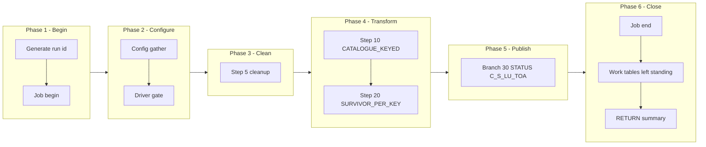

# STGTOA Manifest — m_Tgt_C_S_TRS_Stg_TOA, config-driven step-driver refactor (TRS)

Prefix: `TRS_STGTOA` (short: `STGTOA`). Workflow: `wf_TRS_Stage_Load_TOA`.
Baseline (read-only, never modified): `snowflake_multisource/TRS/mappings/sp_snow_main_m_Tgt_C_S_TRS_Stg_TOA.sql`.
Driver file: `drivers/driver_sp_snow_main_m_Tgt_C_S_TRS_Stg_TOA.sql`.

## Driver

Signature (IDENTICAL to the current main, verified by normalised comparison):

```sql
sp_snow_main_m_Tgt_C_S_TRS_Stg_TOA (

    P_JOB_RUN_ID  VARCHAR DEFAULT NULL

) RETURNS VARCHAR
```

Driver behaviour: job-run-id generation exactly as now + `sp_etl_job_begin`;
one config GATHER (nested `BEGIN/EXCEPTION`, defaults stand on failure) from
`COMMON.ETL_RUN_CONFIG_TBL` (`WORKFLOW_NAME = 'wf_TRS_Stage_Load_TOA'`,
`MAPPING_NAME = 'm_Tgt_C_S_TRS_Stg_TOA'`); driver-row `STEP_NO = 0` = `'N'` skips the
whole mapping BEFORE step 5 cleanup (SKIPPED checkpoint `MAPPING_SKIPPED`,
`sp_etl_job_finish` with a skipped message, early RETURN); step 5 cleanup
unchanged (2 bare `DROP TABLE IF EXISTS`, no checkpoint); conditional step
calls in order; ONE publish transaction calling the enabled branch procs in
order; branch checkpoints ONLY after `COMMIT`; `TERMINATING` via
`sp_etl_job_finish` with the same message style and RETURN format as now;
exception block identical in shape (ROLLBACK + TERMINATING `JOB_END`
FAILED checkpoint in the 10-argument form + `sp_etl_job_fail` + RAISE).

## Steps

| STEP_NO | Proc | Kind | Checkpoint STEP_NAME | Produces | Consumes default | DEPENDENT_ON | Original params used |
|---|---|---|---|---|---|---|---|
| 10 | `sp_snow_step_TRS_STGTOA_S10_KEYED` | TRANSFORM | `CATALOGUE_KEYED` | `WRK_TRS_LUTOA_S10_KEYED` | (base tables only) | — | none |
| 20 | `sp_snow_step_TRS_STGTOA_S20_FINAL` | TRANSFORM | `SURVIVOR_PER_KEY` | `WRK_TRS_LUTOA_S20_FINAL` | WRK_TRS_LUTOA_S10_KEYED | 10 | none |

Step proc signatures: the step's used original params (in original order) +
`P_JOB_RUN_ID VARCHAR DEFAULT NULL` + `P_RUN_TS TIMESTAMP_NTZ DEFAULT NULL`
+ `P_INPUT_TABLES VARCHAR DEFAULT '<consumes default>'`. Every step proc
returns `NUMBER` (row count), writes its own checkpoint in the 10-argument
form (`P_SOURCE, P_JOB_RUN_ID, P_WORKFLOW_NAME, P_MAPPING_NAME, P_STATE,
P_STEP_NAME, P_STEP_STATUS, P_TARGET_TABLE, P_MESSAGE, P_ERROR_MESSAGE`),
has no exception block, no transaction, no target write, and starts with
the work-table existence check (skipped when `P_INPUT_TABLES` is
NULL/empty; the probe surfaces the native missing-table error because
RAISE cannot carry a dynamic table name). `P_INPUT_TABLES` is a dependency
declaration + runtime check, NOT dynamic SQL — each CTAS still names its
source work table literally.

Step files: `steps/sp_snow_step_TRS_STGTOA_S<nn>_<NAME>.sql` (2 files).

## Publish branches

Original publish was one step 30 with 1 INSERTs in one transaction. Each
INSERT is now one branch proc, called by the driver inside ONE transaction
in the same order, checkpointed by the driver only after COMMIT. All
branches stay inside a SINGLE Publish subgraph in the diagram below;
spine / status / exception groups are distinguished by label prefixes
inside that subgraph, never by splitting the transaction.

| STEP_NO | Proc | Kind | Target | Consumes | DEPENDENT_ON | Original params used |
|---|---|---|---|---|---|---|
| 30 | `sp_snow_pub_TRS_STGTOA_C_S_LU_TOA` | STATUS | `C_S_LU_TOA` | WRK_TRS_LUTOA_S20_FINAL | 20 | none |

Branch proc signatures: the branch INSERT's used original params (in
original order) + `P_JOB_RUN_ID VARCHAR DEFAULT NULL` +
`P_RUN_TS TIMESTAMP_NTZ DEFAULT NULL` +
`P_INPUT_TABLES VARCHAR DEFAULT '<consumes default>'`. Each returns
`SQLROWCOUNT` as `NUMBER`. No transaction control, no checkpoint calls.
Driver checkpoint STEP_NAMEs are the `PUBLISH_*` names in the table above.

Branch files: `publish/sp_snow_pub_TRS_STGTOA_<TARGET>[_<BRANCH>].sql` (1 files).

## Preserved quirks (verbatim substance from the current main header)

(kept deliberately, do not "fix" silently)
  * Insert-only, as in the original Snowflake code: no TRUNCATE, no
    DELETE of the target.  IDQ truncates C_S_LU_TOA; the Snowflake
    version instead skips keys already present (VERSION_SEQ = 1) and
    skips null keys.  A re-run therefore inserts nothing twice, but
    it also does not remove rows that IDQ would have truncated away
    -- see the User Guide, "Parity gaps".
  * No validation in IDQ for this mapping: no router, no filter, no
    exception table, and no begin-after-end date check (unlike the
    member TOA mapping, BR-27).  The only checks in the original are
    the target's NOT NULL / unique constraints, ported here as the
    step-20 null-key filter and existing-key guard.  A TOA code with
    no TOA master label leaves PKEY_SRC_OBJECT NULL; IDQ gets the row
    rejected by Oracle and logs nothing, and this version drops it
    silently in step 20 (Snowflake would fail the whole statement on
    the NOT NULL column if it were published).
  * Survivor rule, preserved and flagged: IDQ keeps the first row read
    and its read has no ORDER BY, so the survivor of a code listed
    under several programs or history rows is undefined there; this
    version keeps the latest (UPDATE_DT, then UNIQUE_TRANS_ID,
    descending), as the original Snowflake code did.  Confirm with
    the business if that survivor rule is the intended one.
  * Precision as IDQ: the key passes a string(10) port (cut to 10),
    MBR_PRG_CD a string(9) port, TOA_LBL cut to 100, TOA_DESC to 250
    and UPDATED_BY to 50.
  * VERSION_SEQ = 1 (literal '1'); PERIOD_START_DATE, PERIOD_END_DATE
    and PERIOD_REFERENCE_TIME are NULL (not linked); TIMELINE_ACTION
    keeps the column default 0.  CREATOR = 'admin', HUB_STATE_IND = 1,
    LAST_UPDATE_DATE = run start, CREATE_DATE = source CREATE_DT.
  * ROWID_OBJECT (computed as the key without leading zeros in IDQ,
    but not linked) and DELETED_* are NULL, as in the original.
  * JUDGEMENT CALL, step 20: the original outer SELECT used QUALIFY
    with ROW_NUMBER to pick the survivor.  A CREATE TABLE AS with a
    bare QUALIFY is avoided here; step 20 instead computes the same
    ROW_NUMBER as a column in a subquery and filters rn = 1, dropping
    the helper column with SELECT * EXCLUDE (rn).  Same rows, same
    order, same survivor -- only the spelling differs, so the step
    compiles the same way in a CTAS as it would in an INSERT.

## Verification performed (no live Snowflake available)

- Step CTAS compared to the current file after whitespace normalisation
  and the allowed substitutions only (`:l_run_ts` -> `:P_RUN_TS`,
  `:c_mapping` -> the local constant of the same value): all MATCH.
- Branch INSERTs compared likewise: all MATCH.
- Driver name/signature compared to the current main (normalised): IDENTICAL.
- Counts: 1 driver + 2 step procs + 1 branch procs, covering all 2
  current steps and all 1 current publish INSERTs exactly once.
- Style greps: 0 `DROPPED` checkpoint calls, 0 `P_RESUME_STEP`,
  0 cursors in code, 0 `sp_etl_checkpoint` calls and 0 transaction
  statements in publish-branch code, 0 checkpoint calls between the
  driver's `BEGIN TRANSACTION` and `COMMIT`, `TRANSIENT` work tables
  only with unchanged names, `P_JOB_RUN_ID` in every new proc.
- No live Snowflake compile, run, or row-count parity run was possible
  in this environment; that step is required before use.

## Phase-flow diagram


