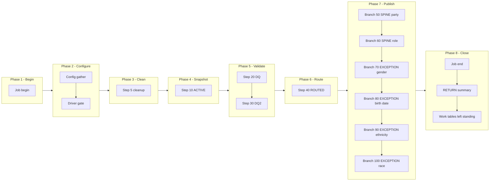

# PTY Manifest - m_Tgt_C_S_TTF_Pty, config-driven step-driver refactor (TTF ONLY)

Prefix: `TTF_PTY`, short: `PTY`. Base dir: `snowflake_all_drivers/TTF/`
(step files in `steps/`, branch files in `publish/`, driver in `drivers/`).
Source verified against: `snowflake_multisource/TTF/mappings/sp_snow_main_m_Tgt_C_S_TTF_Pty.sql`
(step map `snowflake_multisource/TTF/STEP_MAP_TTF.md` agrees; the file was
treated as authoritative throughout).

## What this mapping does

Loads the active TTF clients into the party and party-role tables, and logs demographic exceptions. Gender comes from SEXID (33 -> F, 34 -> M, else U); ethnicity is '55' when RACEETHNICITYID = '55'.

## Driver

Signature (IDENTICAL to the current main, verified by normalised comparison):

```sql
sp_snow_main_m_Tgt_C_S_TTF_Pty (
    P_PTY_BO_CLASS_CD_MEMBER VARCHAR DEFAULT 'Indv',
    P_RLE_BO_CLASS_CD_MEMBER VARCHAR DEFAULT 'Member',
    P_JOB_RUN_ID             VARCHAR DEFAULT NULL
) RETURNS VARCHAR
```

File: `drivers/driver_sp_snow_main_m_Tgt_C_S_TTF_Pty.sql`

Driver behaviour: job-run-id generation exactly as now + `sp_etl_job_begin`;
one config GATHER (nested `BEGIN/EXCEPTION`, defaults stand on failure) from
`COMMON.ETL_RUN_CONFIG_TBL` (`WORKFLOW_NAME = 'wf_TTF_Stage_Load'`,
`MAPPING_NAME = 'm_Tgt_C_S_TTF_Pty'`); driver-row `STEP_NO = 0` = `'N'` skips the
whole mapping BEFORE step 5 cleanup (SKIPPED checkpoint `MAPPING_SKIPPED`,
`sp_etl_job_finish` with a skipped message, early RETURN); step 5 cleanup
unchanged (bare `DROP TABLE IF EXISTS`, no checkpoint); conditional step
calls in order; ONE publish transaction calling the enabled branch procs in
order; branch checkpoints ONLY after `COMMIT`; `TERMINATING` via
`sp_etl_job_finish` with the same message style and RETURN format as now;
exception block identical in shape (ROLLBACK + TERMINATING `JOB_END`
FAILED checkpoint in the v2 10-argument form + `sp_etl_job_fail` + RAISE).

## Steps

| STEP_NO | Proc | Kind | Produces | Consumes default | Checkpoint STEP_NAME |
|---|---|---|---|---|---|
| 10 | `sp_snow_step_TTF_PTY_S10_ACTIVE` | TRANSFORM | `WRK_TTF_PTY_S1_ACTIVE` | _(empty - base tables, check skipped)_ | `ACTIVE` |
| 20 | `sp_snow_step_TTF_PTY_S20_DQ` | TRANSFORM | `WRK_TTF_PTY_S2_DQ` | `WRK_TTF_PTY_S1_ACTIVE` | `DQ` |
| 30 | `sp_snow_step_TTF_PTY_S30_DQ2` | TRANSFORM | `WRK_TTF_PTY_S3_DQ2` | `WRK_TTF_PTY_S2_DQ` | `DQ2` |
| 40 | `sp_snow_step_TTF_PTY_S40_ROUTED` | TRANSFORM | `WRK_TTF_PTY_S4_ROUTED` | `WRK_TTF_PTY_S3_DQ2` | `ROUTED` |

Step proc signatures: the step's used original params (in original order) +
`P_JOB_RUN_ID` + `P_RUN_TS` + `P_INPUT_TABLES` (pipe-delimited default naming
work-table inputs; existence checked via INFORMATION_SCHEMA.TABLES + an
EXECUTE IMMEDIATE probe of the first missing table -- RAISE cannot carry a
dynamic table name so the native error surfaces instead). `P_INPUT_TABLES`
is a declaration + check, NOT dynamic SQL: each CTAS still names its source
work table literally. Every step proc returns `NUMBER` (row count), writes
its own checkpoint in the v2 10-argument form, has no exception block, no
transaction, no target write.

## Publish branches

Original publish was one step 50 with 6 INSERT(s) in one transaction. Each
INSERT is now one branch proc, called by the driver inside ONE transaction
in the same order, checkpointed by the driver only after COMMIT.

| STEP_NO | Proc | Kind | Target | Consumes |
|---|---|---|---|---|
| 50 | `sp_snow_pub_TTF_PTY_C_S_TTF_PTY` | SPINE | `C_S_TTF_PTY` | `WRK_TTF_PTY_S4_ROUTED` | `PUBLISH_C_S_TTF_PTY` |
| 60 | `sp_snow_pub_TTF_PTY_C_S_TTF_PTY_RLE` | SPINE | `C_S_TTF_PTY_RLE` | `WRK_TTF_PTY_S4_ROUTED` | `PUBLISH_C_S_TTF_PTY_RLE` |
| 70 | `sp_snow_pub_TTF_PTY_EXC_STG_BAD_REC_MEMB_GENDER` | EXCEPTION | `EXC_STG_BAD_REC_MEMB` | `WRK_TTF_PTY_S4_ROUTED` | `PUBLISH_EXC_GENDER` |
| 80 | `sp_snow_pub_TTF_PTY_EXC_STG_BAD_REC_MEMB_BIRTH` | EXCEPTION | `EXC_STG_BAD_REC_MEMB` | `WRK_TTF_PTY_S4_ROUTED` | `PUBLISH_EXC_BIRTH` |
| 90 | `sp_snow_pub_TTF_PTY_EXC_STG_BAD_REC_MEMB_ETHNICITY` | EXCEPTION | `EXC_STG_BAD_REC_MEMB` | `WRK_TTF_PTY_S4_ROUTED` | `PUBLISH_EXC_ETHNICITY` |
| 100 | `sp_snow_pub_TTF_PTY_EXC_STG_BAD_REC_MEMB_RACE` | EXCEPTION | `EXC_STG_BAD_REC_MEMB` | `WRK_TTF_PTY_S4_ROUTED` | `PUBLISH_EXC_RACE` |

Branch proc signatures: `P_JOB_RUN_ID` + `P_RUN_TS` +
`P_INPUT_TABLES` (default the final routed table). Each returns
`SQLROWCOUNT` as `NUMBER`. No transaction control, no checkpoint calls.
The first branch takes the current publish step number (50), +10 per branch.

## Parameters

Original parameters, in original order: P_PTY_BO_CLASS_CD_MEMBER ('Indv'), P_RLE_BO_CLASS_CD_MEMBER ('Member'), then P_JOB_RUN_ID. Only step 40 uses the original parameters; it declares them with their original defaults, so its trailing P_JOB_RUN_ID / P_RUN_TS carry DEFAULT NULL (live-compile fix: no required parameter after an optional one) and the driver passes all five positionally. Step 20 uses :P_RUN_TS (birth-date exception code); steps 10 and 30 use neither.

## Flag / input / publish-count naming

Rule: strip the `sp_snow_step_` / `sp_snow_pub_` prefix from the unit's
procedure name, prepend `l_flag_` / `l_in_` / `l_pub_`; the driver-row flag
is `l_flag_TTF_PTY_DRIVER`. Dependencies live in `l_in_*` variables, in
config DEPENDENT_ON, and in TTF_DEPENDENCIES.md -- never in flag names.

| Variable family | Unit |
|---|---|
| `l_flag_TTF_PTY_DRIVER` | driver row (STEP_NO 0) |
| `l_flag_S10_ACTIVE` / `l_in_S10_ACTIVE` | step 10 ACTIVE |
| `l_flag_S20_DQ` / `l_in_S20_DQ` | step 20 DQ |
| `l_flag_S30_DQ2` / `l_in_S30_DQ2` | step 30 DQ2 |
| `l_flag_S40_ROUTED` / `l_in_S40_ROUTED` | step 40 ROUTED |
| `l_flag_TTF_PTY_C_S_TTF_PTY` / `l_in_TTF_PTY_C_S_TTF_PTY` / `l_pub_TTF_PTY_C_S_TTF_PTY` | branch 50 PUBLISH_C_S_TTF_PTY |
| `l_flag_TTF_PTY_C_S_TTF_PTY_RLE` / `l_in_TTF_PTY_C_S_TTF_PTY_RLE` / `l_pub_TTF_PTY_C_S_TTF_PTY_RLE` | branch 60 PUBLISH_C_S_TTF_PTY_RLE |
| `l_flag_TTF_PTY_EXC_STG_BAD_REC_MEMB_GENDER` / `l_in_TTF_PTY_EXC_STG_BAD_REC_MEMB_GENDER` / `l_pub_TTF_PTY_EXC_STG_BAD_REC_MEMB_GENDER` | branch 70 PUBLISH_EXC_GENDER |
| `l_flag_TTF_PTY_EXC_STG_BAD_REC_MEMB_BIRTH` / `l_in_TTF_PTY_EXC_STG_BAD_REC_MEMB_BIRTH` / `l_pub_TTF_PTY_EXC_STG_BAD_REC_MEMB_BIRTH` | branch 80 PUBLISH_EXC_BIRTH |
| `l_flag_TTF_PTY_EXC_STG_BAD_REC_MEMB_ETHNICITY` / `l_in_TTF_PTY_EXC_STG_BAD_REC_MEMB_ETHNICITY` / `l_pub_TTF_PTY_EXC_STG_BAD_REC_MEMB_ETHNICITY` | branch 90 PUBLISH_EXC_ETHNICITY |
| `l_flag_TTF_PTY_EXC_STG_BAD_REC_MEMB_RACE` / `l_in_TTF_PTY_EXC_STG_BAD_REC_MEMB_RACE` / `l_pub_TTF_PTY_EXC_STG_BAD_REC_MEMB_RACE` | branch 100 PUBLISH_EXC_RACE |

## Preserved quirks (kept deliberately, do not "fix" silently)

- Insert-only (IDQ truncate of party / role targets not performed); keys already present are skipped by the uq_pty / uq_rle guards.
- Invalid_Language / Invalid_Suffix groups never write (unfed ports, no branches generated).
- PRFRD_LANG_CD and SFX_NM are NULL (unfed ports).
- VERSION_SEQ = 1; party PERIOD_START_DATE = run start, role PERIOD_START_DATE = SUBMITDATE.
- An exception never stops the party loading; a future birth date is loaded as NULL and logged.
- Every exception class writes one EXC_STG_BAD_REC_MEMB row for every row (no source-table condition in TTF).

## Phase-flow diagram

Phases follow the actual driver flow. Publish is ONE phase and ONE
transaction: spine / status / exception groups are distinguished by label
prefixes inside the single Publish subgraph, never by splitting the
transaction across subgraphs.



## Verification performed (no live Snowflake available)

- All 4 step CTAS compared to the current file after whitespace normalisation
  and the allowed substitution only (`:l_run_ts` -> `:P_RUN_TS`,
  `:c_mapping` -> the local constant of the same name): all MATCH.
- All 6 branch INSERTs compared likewise: all MATCH.
- Driver name/signature compared to the current main (normalised): IDENTICAL.
- Counts: 1 driver + 4 step procs + 6 branch procs, covering all
  current steps and all current publish INSERTs exactly once.
- Style greps (code): 0 checkpoint calls for drops, 0 `P_RESUME_STEP`,
  0 cursors, 0 `sp_etl_checkpoint` calls and 0 transaction statements in
  publish-branch code, 0 checkpoint calls between the driver's
  `BEGIN TRANSACTION` and `COMMIT`, `TRANSIENT` work tables only with
  unchanged names, `P_JOB_RUN_ID` in every new proc.
- Every `sp_etl_checkpoint` call parses (balanced-paren) to exactly 10
  arguments; no `||` in any `COMMENT ON`; no required-after-optional
  signature order (the one step with defaulted original params, where
  applicable, carries DEFAULT NULL on its trailing params).

## Deviations / uncertainties -- nothing silently shipped

1. **Combined publish checkpoint split (by design, per brief).** The current
   file writes ONE step-50 `PUBLISH` checkpoint with the summed row count.
   The refactor writes one checkpoint per branch (STEP_NOs
   50, 60, 70, 80, 90, 100) with that branch's count, plus a per-branch helper36
   summary line instead of the single `step 50 PUBLISH` line. Total published rows
   are recoverable by summing the branch counts; there is no longer a
   single combined publish row.
2. **Config columns not read.** `IS_DEPENDENT`, `DEPENDENT_ON` and
   `WORK_TABLES_PRODUCED` exist in `ETL_RUN_CONFIG_TBL` but are not read by
   this driver; gating is by `IS_RUN_ENABLED` only, per the brief.
3. **No cascade on skip.** Skipping is per step/branch only. If an upstream
   step is disabled but a downstream step stays enabled, the downstream
   step's existence check raises the missing work table rather than running
   on stale data. Operators must disable downstream steps explicitly.
4. **'SKIPPED' status is a choice to confirm.** `JOB_CONTROL_ETL.STEP_STATUS`
   has no CHECK constraint (only a DDL comment listing
   STARTED | COMPLETED | FAILED); `SKIPPED` rows are used here as specified
   and should be confirmed by the user.
5. **Compile-time verification items (no live Snowflake here).**
   - `l_rows := (CALL proc(...));` scalar-call capture form.
   - `IF` blocks inside the driver's `BEGIN TRANSACTION` / `COMMIT` region
     (branch CALLs gated by flags), and the multi-variable
     `SELECT ... INTO :a, :b, ...` in the GATHER.
   - Unused-parameter warnings, if any, for `P_RUN_TS` in steps/branches
     where it is carried for signature uniformity.
6. **Not tested.** No live Snowflake compile, run, or row-count parity run
   was possible in this environment; that step is required before use.
7. **Scope.** TTF `m_Tgt_C_S_TTF_Pty` only. No other source or mapping was touched; the
   current main file was not modified.
