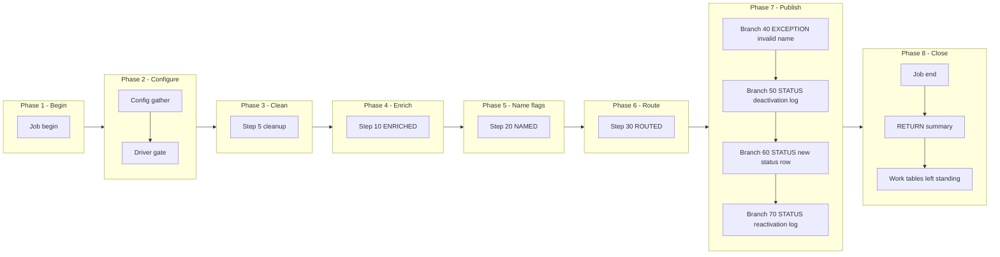

# VAL Manifest - m_Tgt_C_S_TTF_Pty_Validation, config-driven step-driver refactor (TTF ONLY)

Prefix: `TTF_VAL`, short: `VAL`. Base dir: `snowflake_all_drivers/TTF/`
(step files in `steps/`, branch files in `publish/`, driver in `drivers/`).
Source verified against: `snowflake_multisource/TTF/mappings/sp_snow_main_m_Tgt_C_S_TTF_Pty_Validation.sql`
(step map `snowflake_multisource/TTF/STEP_MAP_TTF.md` agrees; the file was
treated as authoritative throughout).

## What this mapping does

Reads TTF clients, standardises their names, and maintains the deactivation list every later TTF mapping relies on.

## Driver

Signature (IDENTICAL to the current main, verified by normalised comparison):

```sql
sp_snow_main_m_Tgt_C_S_TTF_Pty_Validation (
    P_JOB_RUN_ID VARCHAR DEFAULT NULL
) RETURNS VARCHAR
```

File: `drivers/driver_sp_snow_main_m_Tgt_C_S_TTF_Pty_Validation.sql`

Driver behaviour: job-run-id generation exactly as now + `sp_etl_job_begin`;
one config GATHER (nested `BEGIN/EXCEPTION`, defaults stand on failure) from
`COMMON.ETL_RUN_CONFIG_TBL` (`WORKFLOW_NAME = 'wf_TTF_Stage_Load'`,
`MAPPING_NAME = 'm_Tgt_C_S_TTF_Pty_Validation'`); driver-row `STEP_NO = 0` = `'N'` skips the
whole mapping BEFORE step 5 cleanup (SKIPPED checkpoint `MAPPING_SKIPPED`,
`sp_etl_job_finish` with a skipped message, early RETURN); step 5 cleanup
unchanged (bare `DROP TABLE IF EXISTS`, no checkpoint); conditional step
calls in order; ONE publish transaction calling the enabled branch procs in
order; branch checkpoints ONLY after `COMMIT`; `TERMINATING` via
`sp_etl_job_finish` with the same message style and RETURN format as now;
exception block identical in shape (ROLLBACK + TERMINATING `JOB_END`
FAILED checkpoint in the v2 10-argument form + `sp_etl_job_fail` + RAISE).

## Steps

| STEP_NO | Proc | Kind | Produces | Consumes default | Checkpoint STEP_NAME |
|---|---|---|---|---|---|
| 10 | `sp_snow_step_TTF_VAL_S10_ENRICHED` | TRANSFORM | `WRK_TTF_VAL_S1_ENRICHED` | _(empty - base tables, check skipped)_ | `ENRICHED` |
| 20 | `sp_snow_step_TTF_VAL_S20_NAMED` | TRANSFORM | `WRK_TTF_VAL_S2_NAMED` | `WRK_TTF_VAL_S1_ENRICHED` | `NAMED` |
| 30 | `sp_snow_step_TTF_VAL_S30_ROUTED` | TRANSFORM | `WRK_TTF_VAL_S3_ROUTED` | `WRK_TTF_VAL_S2_NAMED` | `ROUTED` |

Step proc signatures: the step's used original params (in original order) +
`P_JOB_RUN_ID` + `P_RUN_TS` + `P_INPUT_TABLES` (pipe-delimited default naming
work-table inputs; existence checked via INFORMATION_SCHEMA.TABLES + an
EXECUTE IMMEDIATE probe of the first missing table -- RAISE cannot carry a
dynamic table name so the native error surfaces instead). `P_INPUT_TABLES`
is a declaration + check, NOT dynamic SQL: each CTAS still names its source
work table literally. Every step proc returns `NUMBER` (row count), writes
its own checkpoint in the v2 10-argument form, has no exception block, no
transaction, no target write.

## Publish branches

Original publish was one step 40 with 4 INSERT(s) in one transaction. Each
INSERT is now one branch proc, called by the driver inside ONE transaction
in the same order, checkpointed by the driver only after COMMIT.

| STEP_NO | Proc | Kind | Target | Consumes |
|---|---|---|---|---|
| 40 | `sp_snow_pub_TTF_VAL_EXC_STG_BAD_REC_MEMB` | EXCEPTION | `EXC_STG_BAD_REC_MEMB` | `WRK_TTF_VAL_S3_ROUTED` | `PUBLISH_EXC_STG_BAD_REC_MEMB` |
| 50 | `sp_snow_pub_TTF_VAL_STG_TTF_PTY_INACTIVE_LOG_DEACTIVATION` | STATUS | `STG_TTF_PTY_INACTIVE_LOG` | `WRK_TTF_VAL_S3_ROUTED` | `PUBLISH_STG_TTF_PTY_INACTIVE_LOG_DEACTIVATION` |
| 60 | `sp_snow_pub_TTF_VAL_STG_TTF_PTY_INACTIVE_STS` | STATUS | `STG_TTF_PTY_INACTIVE_STS` | `WRK_TTF_VAL_S3_ROUTED` | `PUBLISH_STG_TTF_PTY_INACTIVE_STS` |
| 70 | `sp_snow_pub_TTF_VAL_STG_TTF_PTY_INACTIVE_LOG_REACTIVATION` | STATUS | `STG_TTF_PTY_INACTIVE_LOG` | `WRK_TTF_VAL_S3_ROUTED` | `PUBLISH_STG_TTF_PTY_INACTIVE_LOG_REACTIVATION` |

Branch proc signatures: `P_JOB_RUN_ID` + `P_RUN_TS` +
`P_INPUT_TABLES` (default the final routed table). Each returns
`SQLROWCOUNT` as `NUMBER`. No transaction control, no checkpoint calls.
The first branch takes the current publish step number (40), +10 per branch.

## Parameters

No original parameters. Driver signature is the main's signature exactly: P_JOB_RUN_ID only (appended in the simplified main, kept here). Step procs take only P_JOB_RUN_ID + P_RUN_TS + P_INPUT_TABLES; step 30 materialises run_ts and mapping_name from :P_RUN_TS and the local constant.

## Flag / input / publish-count naming

Rule: strip the `sp_snow_step_` / `sp_snow_pub_` prefix from the unit's
procedure name, prepend `l_flag_` / `l_in_` / `l_pub_`; the driver-row flag
is `l_flag_TTF_VAL_DRIVER`. Dependencies live in `l_in_*` variables, in
config DEPENDENT_ON, and in TTF_DEPENDENCIES.md -- never in flag names.

| Variable family | Unit |
|---|---|
| `l_flag_TTF_VAL_DRIVER` | driver row (STEP_NO 0) |
| `l_flag_S10_ENRICHED` / `l_in_S10_ENRICHED` | step 10 ENRICHED |
| `l_flag_S20_NAMED` / `l_in_S20_NAMED` | step 20 NAMED |
| `l_flag_S30_ROUTED` / `l_in_S30_ROUTED` | step 30 ROUTED |
| `l_flag_TTF_VAL_EXC_STG_BAD_REC_MEMB` / `l_in_TTF_VAL_EXC_STG_BAD_REC_MEMB` / `l_pub_TTF_VAL_EXC_STG_BAD_REC_MEMB` | branch 40 PUBLISH_EXC_STG_BAD_REC_MEMB |
| `l_flag_TTF_VAL_STG_TTF_PTY_INACTIVE_LOG_DEACTIVATION` / `l_in_TTF_VAL_STG_TTF_PTY_INACTIVE_LOG_DEACTIVATION` / `l_pub_TTF_VAL_STG_TTF_PTY_INACTIVE_LOG_DEACTIVATION` | branch 50 PUBLISH_STG_TTF_PTY_INACTIVE_LOG_DEACTIVATION |
| `l_flag_TTF_VAL_STG_TTF_PTY_INACTIVE_STS` / `l_in_TTF_VAL_STG_TTF_PTY_INACTIVE_STS` / `l_pub_TTF_VAL_STG_TTF_PTY_INACTIVE_STS` | branch 60 PUBLISH_STG_TTF_PTY_INACTIVE_STS |
| `l_flag_TTF_VAL_STG_TTF_PTY_INACTIVE_LOG_REACTIVATION` / `l_in_TTF_VAL_STG_TTF_PTY_INACTIVE_LOG_REACTIVATION` / `l_pub_TTF_VAL_STG_TTF_PTY_INACTIVE_LOG_REACTIVATION` | branch 70 PUBLISH_STG_TTF_PTY_INACTIVE_LOG_REACTIVATION |

## Preserved quirks (kept deliberately, do not "fix" silently)

- Insert-only (IDQ truncate not performed); the IDQ DD_DELETE of STG_TTF_PTY_INACTIVE_STS (Upd_Delete_Inactive) is NOT performed, so a reactivated party keeps its status row and reactivation is a log row only.
- A DO_NOT_DISCLOSE name is logged as an exception but does NOT deactivate the party (deactivation tests blank or DECLINED only, plus CLIENT_EXISTS_FLAG = N).
- The source WHERE fragment (test client ids) is not applied, as in the main.
- Cross-reference filter is TRIM(ROWID_SYSTEM) = 'TTF'.
- Exception uniqueness is by the uq_exc_name flag (first row per key in the run), not enforced by Snowflake.

## Phase-flow diagram

Phases follow the actual driver flow. Publish is ONE phase and ONE
transaction: spine / status / exception groups are distinguished by label
prefixes inside the single Publish subgraph, never by splitting the
transaction across subgraphs.



## Verification performed (no live Snowflake available)

- All 3 step CTAS compared to the current file after whitespace normalisation
  and the allowed substitution only (`:l_run_ts` -> `:P_RUN_TS`,
  `:c_mapping` -> the local constant of the same name): all MATCH.
- All 4 branch INSERTs compared likewise: all MATCH.
- Driver name/signature compared to the current main (normalised): IDENTICAL.
- Counts: 1 driver + 3 step procs + 4 branch procs, covering all
  current steps and all current publish INSERTs exactly once.
- Style greps (code): 0 checkpoint calls for drops, 0 `P_RESUME_STEP`,
  0 cursors, 0 `sp_etl_checkpoint` calls and 0 transaction statements in
  publish-branch code, 0 checkpoint calls between the driver's
  `BEGIN TRANSACTION` and `COMMIT`, `TRANSIENT` work tables only with
  unchanged names, `P_JOB_RUN_ID` in every new proc.
- Every `sp_etl_checkpoint` call parses (balanced-paren) to exactly 10
  arguments; no `||` in any `COMMENT ON`; no required-after-optional
  signature order (the one step with defaulted original params, where
  applicable, carries DEFAULT NULL on its trailing params).

## Deviations / uncertainties -- nothing silently shipped

1. **Combined publish checkpoint split (by design, per brief).** The current
   file writes ONE step-40 `PUBLISH` checkpoint with the summed row count.
   The refactor writes one checkpoint per branch (STEP_NOs
   40, 50, 60, 70) with that branch's count, plus a per-branch helper36
   summary line instead of the single `step 40 PUBLISH` line. Total published rows
   are recoverable by summing the branch counts; there is no longer a
   single combined publish row.
2. **Config columns not read.** `IS_DEPENDENT`, `DEPENDENT_ON` and
   `WORK_TABLES_PRODUCED` exist in `ETL_RUN_CONFIG_TBL` but are not read by
   this driver; gating is by `IS_RUN_ENABLED` only, per the brief.
3. **No cascade on skip.** Skipping is per step/branch only. If an upstream
   step is disabled but a downstream step stays enabled, the downstream
   step's existence check raises the missing work table rather than running
   on stale data. Operators must disable downstream steps explicitly.
4. **'SKIPPED' status is a choice to confirm.** `JOB_CONTROL_ETL.STEP_STATUS`
   has no CHECK constraint (only a DDL comment listing
   STARTED | COMPLETED | FAILED); `SKIPPED` rows are used here as specified
   and should be confirmed by the user.
5. **Compile-time verification items (no live Snowflake here).**
   - `l_rows := (CALL proc(...));` scalar-call capture form.
   - `IF` blocks inside the driver's `BEGIN TRANSACTION` / `COMMIT` region
     (branch CALLs gated by flags), and the multi-variable
     `SELECT ... INTO :a, :b, ...` in the GATHER.
   - Unused-parameter warnings, if any, for `P_RUN_TS` in steps/branches
     where it is carried for signature uniformity.
6. **Not tested.** No live Snowflake compile, run, or row-count parity run
   was possible in this environment; that step is required before use.
7. **Scope.** TTF `m_Tgt_C_S_TTF_Pty_Validation` only. No other source or mapping was touched; the
   current main file was not modified.
