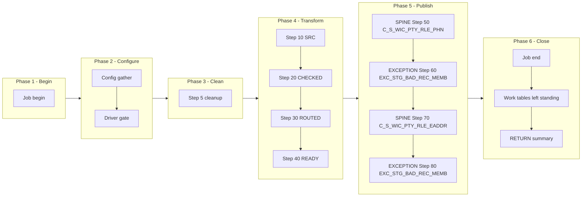

# PHN Manifest — m_Tgt_C_S_WIC_Pty_Rle_Phn_And_EAddr, config-driven step-driver refactor (WIC ONLY)
Prefix: `WIC_PHN`, short: `PHN`. Base dir: `snowflake_all_drivers/WIC/`.
Source verified against: `snowflake_multisource/WIC/mappings/sp_snow_main_m_Tgt_C_S_WIC_Pty_Rle_Phn_And_EAddr.sql` (step map `snowflake_multisource/WIC/STEP_MAP_WIC.md` agrees; where the step map and the file agreed, no discrepancy was found).
## Driver
Signature (IDENTICAL to the current main, verified by normalised comparison):

```sql
sp_snow_main_m_Tgt_C_S_WIC_Pty_Rle_Phn_And_EAddr (

    P_JOB_RUN_ID VARCHAR DEFAULT NULL

) RETURNS VARCHAR
```
File: `drivers/driver_sp_snow_main_m_Tgt_C_S_WIC_Pty_Rle_Phn_And_EAddr.sql`

Driver behaviour: job-run-id generation exactly as now (WIC_ prefix) + `sp_etl_job_begin`; one config GATHER (nested `BEGIN/EXCEPTION`, defaults stand on failure) from `COMMON.ETL_RUN_CONFIG_TBL` (`WORKFLOW_NAME = 'wf_WIC_Stage_Load'`, `MAPPING_NAME = 'm_Tgt_C_S_WIC_Pty_Rle_Phn_And_EAddr'`); driver-row `STEP_NO = 0` = `'N'` skips the whole mapping BEFORE step 5 cleanup (SKIPPED checkpoint `MAPPING_SKIPPED`, `sp_etl_job_finish` with a skipped message, early RETURN); step 5 cleanup unchanged (bare `DROP TABLE IF EXISTS`, no checkpoint); conditional step calls in order; ONE publish transaction calling the enabled branch procs in order; branch checkpoints ONLY after `COMMIT`; `TERMINATING` via `sp_etl_job_finish` with the same message style and RETURN format as now; exception block identical in shape (ROLLBACK + TERMINATING `JOB_END` FAILED checkpoint in v2 10-argument form + `sp_etl_job_fail` + RAISE). The exception checkpoint message uses the INFORMATION_SCHEMA wording (see ECI v2.1), not the old VW_ETL_OPEN_WORK_TABLES wording from the WIC mains.
## Steps

| STEP_NO | Proc | Kind | Produces | Consumes default | Original params used | Checkpoint STEP_NAME |
|---|---|---|---|---|---|---|
| 10 | `sp_snow_step_WIC_PHN_S10_SRC` | TRANSFORM | `WRK_WIC_PHN_S10_SRC` — Active source rows only (deactivation-status filter) plus party-role, phone and e-mail keys, standardised phone, and the e-mail validation object (NULL when e-mail is null). Only step that reads V_WIC_ETL_SRC. | `` | none | `SRC` |
| 20 | `sp_snow_step_WIC_PHN_S20_CHECKED` | TRANSFORM | `WRK_WIC_PHN_S20_CHECKED` — Phone exception code from the area-code lookup (usage 001); standardised e-mail pulled out. | `WRK_WIC_PHN_S10_SRC` | none | `CHECKED` |
| 30 | `sp_snow_step_WIC_PHN_S30_ROUTED` | TRANSFORM | `WRK_WIC_PHN_S30_ROUTED` — Phone and e-mail exception descriptions, codes and types resolved; good and bad routing groups for phones and e-mails. | `WRK_WIC_PHN_S20_CHECKED` | none | `ROUTED` |
| 40 | `sp_snow_step_WIC_PHN_S40_READY` | TRANSFORM | `WRK_WIC_PHN_S40_READY` — Run constants (phone type Telephone, usage 001, preference Primary, e-mail type 001, status Active, valid Y) and the insert-only guards (uq_phn, uq_eaddr, uq_phone_exc, uq_email_exc). Target guards evaluated here, before publish, as in the original single query. | `WRK_WIC_PHN_S30_ROUTED` |  | `READY` |

Step proc signatures: the step's used original params (in original order) + `P_JOB_RUN_ID` + `P_RUN_TS` + `P_INPUT_TABLES` (pipe-delimited default naming work-table inputs; existence checked via INFORMATION_SCHEMA.TABLES + an EXECUTE IMMEDIATE probe of the first missing table — RAISE cannot carry a dynamic table name, so the native error surfaces; P_INPUT_TABLES is a declaration + check, NOT dynamic SQL; CTAS names tables literally). Step runs its CTAS verbatim + own checkpoint. Only the final step uses original params (where the mapping has any); earlier steps use no original params. Where original params carry defaults, `P_JOB_RUN_ID` / `P_RUN_TS` carry DEFAULT NULL (live-compile fix from ECI v2.1: never a required parameter after an optional one; drivers pass all parameters positionally, so behaviour is unchanged). Step files: `steps/sp_snow_step_WIC_PHN_S<nn>_<NAME>.sql`.
## Publish branches

Original publish was one step 50 with 4 INSERTs in one transaction. Each INSERT is now one branch proc, called by the driver inside ONE transaction in the same order, checkpointed by the driver only after COMMIT.

| STEP_NO | Proc | Kind | Target | WHERE guard | Consumes |
|---|---|---|---|---|---|
| 50 | `sp_snow_pub_WIC_PHN_C_S_WIC_PTY_RLE_PHN` | SPINE | `C_S_WIC_PTY_RLE_PHN` (good phones) | `grp_phone_good AND uq_phn` | `WRK_WIC_PHN_S40_READY` |
| 60 | `sp_snow_pub_WIC_PHN_EXC_STG_BAD_REC_MEMB_PHONE` | EXCEPTION | `EXC_STG_BAD_REC_MEMB` (bad-phone exceptions) | `grp_phone_bad AND uq_phone_exc` | `WRK_WIC_PHN_S40_READY` |
| 70 | `sp_snow_pub_WIC_PHN_C_S_WIC_PTY_RLE_EADDR` | SPINE | `C_S_WIC_PTY_RLE_EADDR` (valid e-mails) | `grp_email_good AND uq_eaddr` | `WRK_WIC_PHN_S40_READY` |
| 80 | `sp_snow_pub_WIC_PHN_EXC_STG_BAD_REC_MEMB_EMAIL` | EXCEPTION | `EXC_STG_BAD_REC_MEMB` (bad-e-mail exceptions) | `grp_email_bad AND uq_email_exc` | `WRK_WIC_PHN_S40_READY` |

Branch proc signatures: `P_JOB_RUN_ID` + `P_RUN_TS` + `P_INPUT_TABLES` (default `WRK_WIC_PHN_S40_READY`), no original params. Each returns `SQLROWCOUNT` as `NUMBER`. No transaction control, no checkpoint calls. Driver checkpoint STEP_NAMEs: `PUBLISH_C_S_WIC_PTY_RLE_PHN`, `PUBLISH_EXC_STG_BAD_REC_MEMB_PHONE`, `PUBLISH_C_S_WIC_PTY_RLE_EADDR`, `PUBLISH_EXC_STG_BAD_REC_MEMB_EMAIL`. Branch files: `publish/sp_snow_pub_WIC_PHN_<TARGET>[_<BRANCH>].sql`.
## Phase-flow diagram

Six phases following the actual driver flow. Publish stays ONE subgraph (one transaction); spine, status, exception and validation branch groups are distinguished by label prefixes inside that subgraph, never by splitting the transaction.


## Preserved quirks (business logic preserved, not fixed)

- Insert-only: IDQ truncates of the phone and e-mail targets are not performed.
- No null-phone filter: a party without a phone is validated and logged as an invalid phone.
- The e-mail key uses the e-mail as read (no trim).
- The phone routing groups overlap by construction: a Missing_AreaCode code counts as both good and bad, so the original INSERT ALL would write such a row to both the phone table and the exception table, and the publish INSERTs keep the same WHEN conditions (the original header notes Missing_AreaCode only exists for ECI, so WIC never gets it in practice).
- VERSION_SEQ is 1 on both targets; PERIOD_START_DATE = DATEKEY.

## Verification performed (no live Snowflake available)

- All step CTAS compared to the current file after whitespace normalisation and the allowed substitutions only (`:l_run_ts` → `:P_RUN_TS`, `:c_mapping` → the local constant of the same name and value): all MATCH.
- All branch INSERTs compared likewise: all MATCH.
- Driver name/signature compared to the current main (normalised): IDENTICAL.
- Style greps (code lines): 0 `DROPPED` checkpoint calls, 0 `P_RESUME_STEP`, 0 cursors, 0 `sp_etl_checkpoint` calls and 0 transaction statements in publish-branch code, 0 checkpoint calls between the driver's `BEGIN TRANSACTION` and `COMMIT`, `TRANSIENT` work tables only with unchanged names, `P_JOB_RUN_ID` in every new proc.
- Every `sp_etl_checkpoint` call parses (balanced-paren) to exactly 10 arguments; no `||` in any `COMMENT ON` (no COMMENT ON statements are emitted by this package at all); no required-after-optional signature order.
- Flag/input/publish-count naming uniform under the unit rule (strip `sp_snow_step_` / `sp_snow_pub_`, prepend `l_flag_` / `l_in_` / `l_pub_`); zero `l_flag_[0-9]`, `l_cons_`, `l_run_`, `v_run_`, `l_cfg_` names.
- No live Snowflake compile, run, or row-count parity run was possible in this environment; that step is required before use.
- Scope: WIC `m_Tgt_C_S_WIC_Pty_Rle_Phn_And_EAddr` only. No other source was touched; the current main file was not modified.
## Deviations / uncertainties — nothing silently shipped

1. **Combined publish checkpoint split (by design, per brief).** The current file writes ONE step-50 `PUBLISH` checkpoint with the routed-row count. The refactor writes one checkpoint per branch (STEP_NOs 50–80) with that branch's count, plus a per-branch helper36 summary line instead of the single publish line. Total published rows are recoverable by summing the branch counts; there is no longer a single combined publish row.
2. **Step checkpoint TARGET_TABLE is NULL for every step.** The WIC mains pass NULL as the step target (the publish target list lives only on the old combined publish checkpoint); the refactor keeps NULL on step checkpoints and puts the single branch target on each branch checkpoint.
3. **Config columns not read.** `IS_DEPENDENT`, `DEPENDENT_ON` and `WORK_TABLES_PRODUCED` exist in `ETL_RUN_CONFIG_TBL` but are not read by this driver; gating is by `IS_RUN_ENABLED` only, per the brief.
4. **No cascade on skip.** Skipping is per step/branch only. If an upstream step is disabled but a downstream step stays enabled, the downstream step's existence check raises the missing work table rather than running on stale data. Operators must disable downstream steps explicitly.
5. **'SKIPPED' status is a choice to confirm.** `JOB_CONTROL_ETL.STEP_STATUS` has no CHECK constraint (only a DDL comment listing STARTED | COMPLETED | FAILED); `SKIPPED` rows are used here as specified and should be confirmed by the user.
6. **Compile-time verification items (no live Snowflake here).** `l_rows := (CALL proc(...));` scalar-call capture form; `IF` blocks inside the driver's `BEGIN TRANSACTION` / `COMMIT` region (branch CALLs gated by flags); the multi-variable `SELECT ... INTO :a, :b, ...` in the GATHER; unused-parameter warnings, if any, for `P_RUN_TS` in steps/branches where it is carried for signature uniformity.
